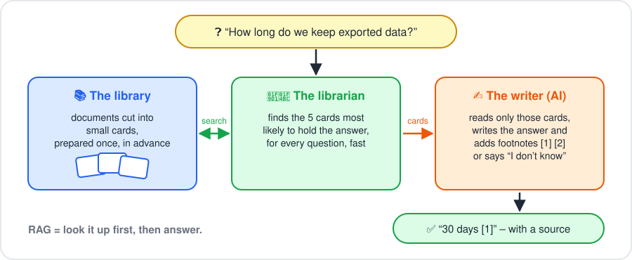

---
jupytext:
  text_representation:
    extension: .md
    format_name: myst
kernelspec:
  display_name: Python 3
  language: python
  name: python3
---

# Lesson 0 · What is RAG? (and how this course works)

> **In one sentence:** RAG means "look it up first, then answer" - just like a person who checks the
> manual before replying, instead of answering from memory.

**Time:** about 20 minutes · **You need:** nothing except this page. No maths, no prior AI knowledge.

---

## A story to start

Imagine you start a new job at a company. On day one your manager asks you:

> *"How many days do we keep customer data after an export?"*

You have two options:

1. **Answer from memory.** You've never seen the company's rules, so you guess. Maybe you say
   "probably 30 days?" with a confident face. If you're wrong, nobody notices until it's too late.
2. **Look it up.** You walk to the company library, find the policy document, read the right
   paragraph, and answer: *"30 days - it says so in the Export Policy, section 2."*

Option 2 is obviously better. It's slower, but the answer is **correct**, **up to date**, and you
can **show where it came from**.

### Chatbots have the same problem

AI chatbots like ChatGPT are like a very well-read new employee. They have read a huge amount of
text on the internet, so they know a lot. But:

- They have **never read your company's documents**, your notes, or last week's update.
- They usually **can't tell you where an answer came from**.
- When they don't know, they often **make up something that sounds right**. People call this
  *hallucination*.

**RAG** (short for **Retrieval-Augmented Generation**) is simply option 2 for chatbots:

| Word | Plain meaning |
|---|---|
| **Retrieval** | *finding* the right pages first |
| **Augmented** | *adding* those pages to the question |
| **Generation** | the AI *writes* an answer using those pages |

---

## The three helpers in our library

Throughout this course we'll use one picture. Think of a small library with three helpers:



*The three helpers. Every lesson in this course improves one of them.*

1. **The library** - Before anyone asks anything, we cut our documents into small pieces
   (we'll call them **chunks**, think "index cards") and organise them so they're easy to search.
   This happens **once**, ahead of time.
2. **The librarian** (the *retriever*) - When a question comes in, the librarian finds the few
   cards most likely to contain the answer. This happens **for every question**, and must be fast.
3. **The writer** (the *language model*, or *LLM*) - The writer reads only those cards and writes
   a short answer, pointing to the card each fact came from. If the cards don't contain the
   answer, a good writer says *"I don't know"* instead of guessing.

Almost every fancy RAG technique you will ever hear about is just a way to make **one of these
three helpers** do a better job.

---

## How this course is organised

| Part | Lessons | In plain words |
|---|---|---|
| Building the library | 1 · Cutting documents into cards<br>2 · Turning text into numbers | how to prepare your documents |
| Training the librarian | 3 · Search by meaning<br>4 · Search by keywords<br>5 · Combining two searches<br>6 · A second, more careful check | how to find the right cards |
| The writer | 7 · Answering only from the cards | how to get honest answers with sources |
| Checking the work | 8 · Grading the system | how to know if a change really helped |
| Advanced tricks | 9 · Improving the question<br>10 · A system that checks itself | ideas from the newest RAG research |

Each lesson follows the same pattern:

1. **A story or picture** that explains the idea without any jargon.
2. **Code you just run** (you don't need to write it) - with a note saying what you should see.
3. **A small exercise** where you write a few lines yourself. A checker tells you ✅ or ❌ and gives a hint.
4. **A short recap** and links if you want to dig deeper.

```{admonition} How to run code in JupyterLab
:class: tip
- Click on a grey code box, then press **Shift + Enter**. The code runs and the result appears underneath.
- Run the boxes **from top to bottom** - later boxes use things created by earlier ones.
- If something looks broken, use the menu **Kernel → Restart Kernel and Run All Cells**.
- You are working on **your own copy** (in the `workspace` folder). You can't break the original.
  To start a lesson again from scratch, ask the course owner to run `scripts/lab reset 03` (for lesson 3).
- Stuck on an exercise? The answers are on the **Solutions** page. Try first - you learn more that way.
```

---

## Let's watch a complete RAG system work

Don't worry about understanding the code yet. Just run each box and read the explanation.
We'll take every piece apart in the coming lessons.

### Step 1 · Build the library

Our library is the official documentation of Python (a programming language) - 45 real
documents, from `json` (saving data as text) to `random` (random numbers).

The box below does three things:
- **loads** the 45 documents,
- **cuts** them into small cards (chunks),
- and **indexes** them so they can be searched (this takes about 10-40 seconds the first time,
  because a small AI model reads every card).

```{code-cell} ipython3
from raglab import load_documents, chunk_documents
from raglab.retrieval import VectorRetriever

docs = load_documents("python_docs")
print("Documents in the library:", len(docs))
print("Example title:", docs[0].title)

chunks = chunk_documents(docs, method="recursive", max_chars=800)
print("Cards after cutting:", len(chunks))

librarian = VectorRetriever(chunks)
print("The librarian is ready!")
```

**What you should see:** 45 documents became several hundred cards, and the librarian is ready.

### Step 2 · Ask the librarian

Now we ask a question in normal English. Notice that we never say the name of the function -
we just describe what we want to do.

```{code-cell} ipython3
from raglab.display import hits_table

cards = librarian.search("How do I turn a Python dict into a JSON string?", k=3)
hits_table(cards)
```

**What you should see:** a small table with the 3 best cards. Each row shows:

- **score** - how well the card matches the question (higher = better match),
- **doc_id** - which document the card came from,
- **preview** - the start of the card's text.

The top cards should come from `py.json` - the right document - and mention `dumps`, the function
that does exactly this. The librarian found it **even though our question never said "dumps"**.
It understood the *meaning*. You'll learn how in lessons 2 and 3.

### Step 3 · Let the writer answer

The writer is an AI language model. It needs to be connected first (the course owner does this
once). If it isn't connected yet, the box simply prints instructions - everything in lessons 1-6
works without it.

```{code-cell} ipython3
from raglab import llm
from raglab.rag import SimpleRAG

if llm.llm_available():
    rag = SimpleRAG(librarian, k=3)
    display(rag.ask("How do I turn a Python dict into a JSON string?"))
else:
    print(llm.explain_setup())
```

**What you should see:** a short answer with little numbers like **[1]** in it. Each number
points to one of the cards listed under **Sources**. That's how you can check the answer:
open the source and see if it really says that.

---

## What just happened? (the whole course in four lines)

| What the code did | Which helper | Lesson |
|---|---|---|
| `chunk_documents` cut 45 documents into small cards | 📚 library | 1 |
| `VectorRetriever` turned each card into a list of numbers that captures its meaning | 📚 library | 2 |
| `librarian.search` found the cards closest in meaning to the question | 🧑‍💼 librarian | 3-6 |
| `SimpleRAG` gave those cards to the AI and asked for an answer with footnotes | ✍️ writer | 7 |

## Recap

- RAG = **look it up first, then answer** - from your own documents, with sources.
- Three helpers: the **library** (prepared once), the **librarian** (finds cards), the **writer** (answers from them).
- If an answer is wrong, the first question is always: *did the librarian bring the right cards?*

## Want to go deeper? (optional)

These free projects by other people cover the same big picture. You can open the local copies
from the file panel on the left, in the `references` folder.

- *RAG from scratch* (by LangChain) - videos and notebooks 1-4 show the same big picture:
  [GitHub](https://github.com/langchain-ai/rag-from-scratch) · `references/langchain-ai_rag-from-scratch/rag_from_scratch_1_to_4.ipynb`
- *Simple local RAG* builds a whole system in one long notebook:
  [GitHub](https://github.com/mrdbourke/simple-local-rag) · `references/mrdbourke_simple-local-rag/00-simple-local-rag.ipynb`
