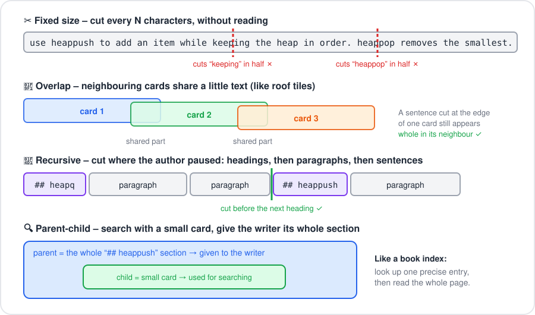

---
jupytext:
  text_representation:
    extension: .md
    format_name: myst
kernelspec:
  display_name: Python 3
  language: python
  name: python3
---

# Lesson 1 · Cutting documents into cards ("chunking")

> **In one sentence:** before we can search our documents, we cut them into small pieces -
> small enough to be precise, big enough to still make sense on their own.

**Time:** about 40 minutes · **You will:** see three ways to cut a document, and write the simplest one yourself.

---

## Why cut documents at all?

Imagine you ask a friend: *"What time does the pharmacy open on Sundays?"*

- **Bad answer:** they hand you the entire 300-page city guide and say *"it's in there somewhere."*
- **Good answer:** they hand you the one card that says *"Pharmacy - Sundays 10:00-16:00."*

Both answers technically contain the information. But only the second one is useful.

Our library works the same way. If we stored each document as one big block, the librarian
could only ever hand back **whole documents** - and the writer would have to dig through pages of
irrelevant text to find one sentence. That's slow, expensive (AI models charge by the amount of
text they read), and error-prone (more text = more chances to get distracted).

So we cut every document into small pieces. In RAG these pieces are called **chunks**. In this
course we'll often call them **cards**, like index cards in a library.

### The Goldilocks problem

How big should a card be? Like Goldilocks' porridge, it must be "just right":

| Cards too small | Cards too big |
|---|---|
| *"...it returns it unchanged."* - **What** returns **what**? The card makes no sense alone. | The card is about ten different things, so it's a weak match for any one question. |
| Like a single sentence torn out of a recipe: *"Bake for 20 minutes."* Bake what? | Like handing over the whole cookbook to answer *"how long do I bake the bread?"* |

There is no perfect size for every situation - that's why we'll try different ones.

---

Here are the four ways of cutting that we'll try in this lesson, at a glance:



*Scissors that don't read, overlapping tiles, cutting at the author's pauses, and small-card-inside-big-section.*

---

## Let's look at a real document

We'll use the documentation for `heapq`, a Python tool for keeping things sorted by priority
(think of a hospital waiting room where the most urgent patient is always seen first).

The box below loads all documents and picks out that one. Run it.

```{code-cell} ipython3
from raglab import load_documents

docs = load_documents("python_docs")
doc = next(d for d in docs if d.doc_id == "py.heapq")

print("This document has", len(doc.text), "characters (letters, spaces, symbols).")
print("Here are the first 600 characters:\n")
print(doc.text[:600])
```

**What you should see:** a few thousand characters in total, starting with a title line
beginning with `#`. Lines beginning with `##` are **section headings** - remember that, it matters soon.

---

## Way 1 · Cut every N characters ("fixed-size")

The simplest possible method: count characters, and cut every time you reach, say, 300.
Like cutting a long paper strip with scissors every 30 cm, without looking at what's written on it.

The problem: you might cut right through the middle of a word or sentence:

```text
card 1: "...use heappush to add an item while keeping the he"
card 2: "ap in order. heappop removes the smallest..."
```

Neither card contains the full sentence. If someone asks about that sentence, both cards are
only half-useful.

### The fix: overlap

The trick is to let neighbouring cards **share a little bit** of text, like roof tiles that
overlap so no rain gets through the gaps. If card 2 starts a bit *before* card 1 ends, a sentence
cut at the edge of card 1 appears in full in card 2.

Here's a tiny example with the alphabet, using cards of **10 letters** that **overlap by 4**:

```text
text:    abcdefghijklmnopqrstuvwxyz

card 1:  abcdefghij                    (letters 1-10)
card 2:        ghijklmnop              (starts 6 letters later: 10 - 4 = 6)
card 3:              mnopqrstuv        (6 more letters later)
card 4:                    stuvwxyz    (reaches the end -> stop)
```

See how `ghij` is in both card 1 and card 2? That shared part is the overlap.
Each new card starts **size - overlap** letters after the previous one (here 10 - 4 = 6).

### ✏️ Exercise 1.1 · Write the card cutter yourself

Fill in the function below. It receives:

- `text` - the text to cut,
- `size` - how many characters each card may have,
- `overlap` - how many characters neighbouring cards share,

and it must return a **list** of cards (strings).

**Step-by-step hints:**

1. Work out the step: `step = size - overlap`.
2. Make an empty list: `pieces = []`.
3. Loop over start positions: `for start in range(0, len(text), step):`
4. Inside the loop, cut one card: `text[start:start + size]` and add it to `pieces`.
5. If this card already reaches the end of the text (`start + size >= len(text)`), `break` out of
   the loop - otherwise you'd get extra tiny cards at the end.
6. After the loop, `return pieces`.

Replace the line `raise NotImplementedError` with your code.

```{code-cell} ipython3
def fixed_size_chunks(text: str, size: int, overlap: int) -> list[str]:
    # YOUR CODE HERE
    raise NotImplementedError
```

Now run the checker. It tests your function on a few small examples (including the alphabet
example above) and tells you what's wrong if something fails.

```{code-cell} ipython3
from raglab.checks import check_fixed_size_chunker
check_fixed_size_chunker(fixed_size_chunks)
```

**What you should see:** ⏳ "not implemented yet" until you write your code, then ❌ with a hint
if something is off, and finally ✅ when everything works.

### See the problem with real text

Here is a ready-made version cutting our `heapq` document into 300-character cards with a
50-character overlap. Look at the start and end of each card:

```{code-cell} ipython3
from raglab.chunking import fixed_size_chunks as ready_made_cutter

for number, card in enumerate(ready_made_cutter(doc.text, 300, 50)[:3], start=1):
    print(f"----- card {number} -----")
    print(card)
    print()
```

**What you should see:** cards that start or end in the middle of a word or sentence. The
scissors don't read - they just count.

---

## Way 2 · Cut where the author paused ("recursive")

A smarter person with scissors would **read** the text and cut at natural places:

1. First, between **sections** (the `##` headings).
2. If a section is still too long, between **paragraphs** (blank lines).
3. Still too long? Between **lines**.
4. Still too long? Between **sentences**.
5. As a last resort, between **words**.

It's called *recursive* because it keeps trying the next, smaller kind of cut until every card
fits. Small neighbouring pieces are glued back together so we don't end up with tiny scraps.
This is the method most RAG tools use by default.

The box below cuts the same `heapq` document this way (max 500 characters per card) and shows
the first four cards as boxes:

```{code-cell} ipython3
from raglab.chunking import chunk_documents
from raglab.display import show_chunks

cards = chunk_documents([doc], method="recursive", max_chars=500)
show_chunks(cards, n=4)
```

**What you should see:** each box starts at a sensible place - often a `##` heading - and ends
at the end of a sentence or paragraph. Much easier to read than the scissor cuts above.

---

## Way 3 · Small cards for finding, big pages for reading ("parent-child")

Here's a clever idea. Think of how you use a book's index:

1. You look up a **small, precise** entry: *"heappush ... page 42"*.
2. But then you **read the whole page 42**, not just that one line.

Parent-child chunking does exactly that:

- The **child** is a small card (say 200 characters). Small cards match questions precisely,
  so the librarian uses them for **searching**.
- The **parent** is the whole section the child came from. When the child is found, the writer
  gets the **parent**, so it has enough surrounding context to understand it.

In our code, every card has two fields: `.text` (the small part used for searching) and
`.context` (the bigger part given to the writer).

```{code-cell} ipython3
cards = chunk_documents([doc], method="parent_child", max_chars=200)
card = cards[3]

print("SMALL CARD (used for searching):")
print(card.text)
print("\nBIG SECTION (given to the writer):")
print(card.context[:700])
```

**What you should see:** a short piece of text, then a longer section that contains it.

---

## Comparing the methods on all 45 documents

The table below cuts the **whole library** with each method and counts the cards.
"Median" means "the typical card" - half the cards are shorter, half are longer.

```{code-cell} ipython3
import pandas as pd

rows = []
for method, settings in [("fixed", dict(size=500, overlap=100)),
                         ("recursive", dict(max_chars=500)),
                         ("section", {}),
                         ("parent_child", dict(max_chars=300))]:
    cards = chunk_documents(docs, method=method, **settings)
    lengths = pd.Series([len(c.text) for c in cards])
    rows.append({"method": method, "number of cards": len(cards),
                 "typical card (characters)": int(lengths.median()),
                 "biggest card (characters)": lengths.max()})
pd.DataFrame(rows).set_index("method")
```

**What you should see:** `section` (one card per `##` section) makes fewer cards, but some
of them are **huge** - look at the "biggest card" column.

### ✏️ Exercise 1.2 · Find the giant card (no checker - just think)

1. Run the box below. It finds the biggest card made by the `section` method.
2. Read the first lines of it.
3. Then write 2-3 sentences (as a `#` comment in the box) answering: **why could a huge card like
   this be a problem** for the librarian (finding it) or the writer (reading it)?
   Hint: think back to the "whole city guide" vs. "one card" story at the top.

```{code-cell} ipython3
section_cards = chunk_documents(docs, method="section")
biggest = max(section_cards, key=lambda c: len(c.text))
print(biggest.chunk_id, "-", len(biggest.text), "characters")
print(biggest.text[:400])

# Your answer:
#
```

Compare with the Solutions page when you're done.

---

## Common mix-ups

- **"Characters" vs "words":** our sizes count characters (letters, spaces, punctuation), not words.
  As a rough guide, 1 English word ≈ 5-6 characters.
- **"Smaller is always more precise":** only up to a point. A card like *"It returns None."* is
  precise but useless without knowing what *it* is.
- **"There's one best size":** no - it depends on your documents. We'll *measure* which method
  works best in Lesson 8 instead of guessing.

## Recap

- We cut documents into **cards (chunks)** so the librarian can hand back just the useful part.
- **Fixed-size** cutting is simple but cuts through sentences; **overlap** softens that.
- **Recursive** cutting follows the author's structure: sections → paragraphs → sentences.
- **Parent-child** searches with small cards but gives the writer the bigger section.

**Next lesson:** how does the librarian know which card *means* the same as your question?
We turn text into numbers.

## Want to go deeper? (optional)

- *RAG_Techniques* notebooks on chunking:
  [choose_chunk_size](https://github.com/NirDiamant/RAG_Techniques/blob/main/all_rag_techniques/choose_chunk_size.ipynb),
  [semantic_chunking](https://github.com/NirDiamant/RAG_Techniques/blob/main/all_rag_techniques/semantic_chunking.ipynb),
  [proposition_chunking](https://github.com/NirDiamant/RAG_Techniques/blob/main/all_rag_techniques/proposition_chunking.ipynb) ·
  local copies in `references/NirDiamant_RAG_Techniques/all_rag_techniques/`
- *all-in-rag* (written in Chinese), chapter 2 on loading and cutting documents: `references/datawhalechina_all-in-rag/docs/chapter2/`
