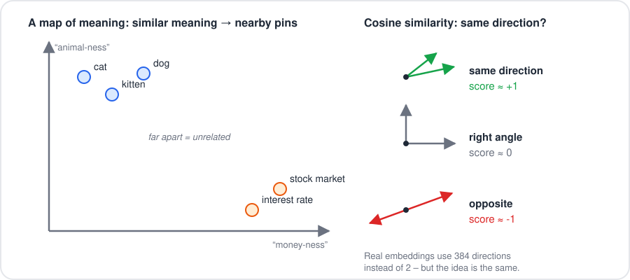

---
jupytext:
  text_representation:
    extension: .md
    format_name: myst
kernelspec:
  display_name: Python 3
  language: python
  name: python3
---

# Lesson 2 · Turning meaning into numbers ("embeddings")

> **In one sentence:** an *embedding* is a list of numbers that describes what a piece of text
> means, so that texts with similar meaning get similar numbers.

**Time:** about 45 minutes · **You will:** understand how a computer can tell that *"kitten"*
and *"cat"* are related, and write the "how similar are these?" formula yourself.

---

## The problem: computers don't understand words

To a computer, `cat` and `kitten` are just two different strings of letters. They share no
letters in the same place, so a simple word-matching computer thinks they have **nothing** in
common. But any child knows they're closely related.

We need a way to describe **meaning** that a computer can compare. Computers are very good at
comparing **numbers**. So the idea is: turn every text into numbers, in such a way that similar
meanings get similar numbers.

## A picture first: a map of meaning

Imagine a big map. Every word or sentence is a pin placed somewhere on it. The rule is:
**things that mean similar things are placed close together.**



*Left: similar meanings sit close together. Right: cosine similarity asks whether two arrows point the same way.*

On this tiny two-direction map, every pin has two numbers: how far right (money-ness) and how
far up (animal-ness). For example, *cat* might be at `[0.1, 0.9]` and *stock market* at `[0.9, 0.1]`.

That pair of numbers **is** an embedding! Real embedding models do the same thing, but instead of
2 directions they use hundreds (our model uses **384**). Nobody chose what each direction means -
the model learned them by reading millions of sentences. You can't draw 384 directions, but the
idea is exactly the same: **close pins = similar meaning**.

---

## First, the naive way: counting words

Before using a real model, let's see why simple word-counting isn't enough. The box below takes
three sentences and counts how often each word appears in each one.

```{code-cell} ipython3
from sklearn.feature_extraction.text import CountVectorizer

sentences = ["the cat sat on the mat",
             "a kitten rested on a rug",
             "the stock market fell today"]

counter = CountVectorizer()
counts = counter.fit_transform(sentences).toarray()

print("Words:", list(counter.get_feature_names_out()))
for sentence, row in zip(sentences, counts):
    print(f"{sentence!r:32} -> {list(row)}")
```

**What you should see:** each sentence became a row of numbers - one number per word in the
whole vocabulary (1 = the word appears, 0 = it doesn't).

Now look at sentences 1 and 2. They mean almost the same thing (a small cat resting on a
floor covering), but the only word they share is **"on"**. Word counting can't see that
*cat ≈ kitten* or *mat ≈ rug*. We need something smarter.

---

## How do we measure "close"? Cosine similarity

Back to our map. Picture each pin as an **arrow** starting from the centre of the map. Two texts
are similar if their arrows **point in the same direction**.

```text
   arrows pointing the same way      →  very similar      (score close to  1)
   arrows at a right angle (90°)     →  unrelated         (score close to  0)
   arrows pointing opposite ways     →  opposite meaning  (score close to -1)
```

Why direction and not distance? Because a long document about cats and a short sentence about
cats should still count as similar. The arrow of a longer text might be longer, but it points
the same way.

The score for "how much do two arrows point the same way" is called **cosine similarity**.
Here's how to calculate it, step by step, for two small arrows `a = [1, 0]` and `c = [3, 4]`:

| Step | What to do | Example |
|---|---|---|
| 1 | Multiply the matching numbers and add them up (this is called the **dot product**) | 1×3 + 0×4 = **3** |
| 2 | Find the length of arrow `a`: square each number, add, take the square root | √(1² + 0²) = **1** |
| 3 | Find the length of arrow `c` the same way | √(3² + 4²) = √25 = **5** |
| 4 | Divide step 1 by (step 2 × step 3) | 3 ÷ (1 × 5) = **0.6** |

So `a` and `c` have a cosine similarity of **0.6** - they point in a somewhat similar direction.

As a formula (you don't need to memorise it):

$$\text{cosine}(a, b) = \frac{a \cdot b}{\text{length}(a) \times \text{length}(b)}$$

### ✏️ Exercise 2.1 · Write cosine similarity

Write the function below using two tools from the `numpy` library:

- `np.dot(a, b)` - does step 1 (multiply matching numbers and add them up)
- `np.linalg.norm(a)` - does steps 2 and 3 (the length of an arrow)

Then do step 4: divide. Wrap the result in `float(...)` so it's a normal number.

```{code-cell} ipython3
import numpy as np

def cosine_similarity(a: np.ndarray, b: np.ndarray) -> float:
    # YOUR CODE HERE (one or two lines is enough)
    raise NotImplementedError
```

```{code-cell} ipython3
from raglab.checks import check_cosine_similarity
check_cosine_similarity(cosine_similarity)
```

**What you should see:** ✅ once your function gives 1.0 for same-direction arrows, 0.0 for
right-angle arrows, -1.0 for opposite arrows, and 0.6 for our example above.

---

## Now with a real embedding model

An **embedding model** is a small AI program trained on millions of pairs of sentences, so that
sentences with similar meaning get arrows pointing in similar directions. We use one called
`bge-small-en-v1.5`. It's small enough to run on a normal computer, and good at English.

The box below gives it our three sentences and shows:
1. the **shape** of the result (3 sentences × 384 numbers each),
2. the first 8 of the 384 numbers for sentence 1 (just so you see what an embedding looks like),
3. a table of cosine similarities between every pair of sentences.

```{code-cell} ipython3
from raglab.embeddings import get_embedder, cosine_similarity as similarity_table
import pandas as pd

model = get_embedder()
vectors = model.embed_passages(sentences, use_cache=False)

print("Shape:", vectors.shape, " (sentences, numbers per sentence)")
print("First 8 numbers of sentence 1:", np.round(vectors[0][:8], 3))

pd.DataFrame(similarity_table(vectors, vectors), index=sentences, columns=sentences).round(2)
```

**What you should see:**

- The numbers themselves look meaningless (like `0.012, -0.054, ...`). That's normal - single
  numbers mean nothing on their own; only comparing whole arrows is meaningful.
- In the table, the diagonal is 1.00 (every sentence is identical to itself).
- *cat on the mat* vs *kitten on a rug* scores clearly **higher** than either of them vs *stock market*.

The model "knows" that a cat on a mat and a kitten on a rug are about the same kind of thing -
even though they share almost no words.

---

## Questions and answers look different

A question (*"How do I pause my program?"*) and the text that answers it (*"Delay execution for
a given number of seconds."*) are worded very differently. Our model was trained to handle this:
before turning a **question** into numbers, it adds a short instruction in front of it, like a
note saying *"this is a question - find text that answers it"*. Our helper does that for you.

The box below has three answer sentences, and three questions that use **completely different
words**. For each question, it finds the most similar answer:

```{code-cell} ipython3
answers = ["Return the median (middle value) of numeric data.",
           "Delay execution for a given number of seconds.",
           "Recursively delete a directory tree."]
answer_vectors = model.embed_passages(answers, use_cache=False)

questions = ["what's the middle number of a list?",
             "how to pause my program",
             "remove a folder and everything in it"]

for question in questions:
    q = model.embed_query(question)            # adds the "this is a question" note
    scores = answer_vectors @ q                # cosine similarity with every answer at once
    best = int(scores.argmax())
    print(f"{question!r:42} -> {answers[best]!r}  (score {scores[best]:.2f})")
```

**What you should see:** every question is matched to the right answer. *"pause my program"*
finds *"Delay execution"*, even though no important word is shared. This is called
**semantic search** - searching by meaning instead of by exact words. It's the librarian's
superpower.

*(Small detail: `answer_vectors @ q` is a quick way to compute the dot product of `q` with every
answer at once. Because the model makes all arrows exactly length 1, the dot product **is** the
cosine similarity - steps 2-4 become "divide by 1 × 1".)*

---

## Seeing the map

We can't draw 384 directions, but there's a trick (called **PCA**) that squashes them down to 2
while keeping as much of the "who is near whom" as possible - like a flat world map squashing
the round Earth. The box below embeds all sections of 7 documents and draws them as dots,
one colour per document:

```{code-cell} ipython3
import matplotlib.pyplot as plt
from sklearn.decomposition import PCA
from raglab import load_documents, chunk_documents

docs = load_documents("python_docs")
picked = ["py.json", "py.csv", "py.pickle", "py.asyncio.tasks", "py.threading", "py.math", "py.statistics"]
cards = [c for c in chunk_documents(docs, "section") if c.doc_id in picked]
xy = PCA(n_components=2).fit_transform(model.embed_passages([c.text for c in cards]))

plt.figure(figsize=(7, 5))
for doc_id in picked:
    rows = [i for i, c in enumerate(cards) if c.doc_id == doc_id]
    plt.scatter(xy[rows, 0], xy[rows, 1], label=doc_id, s=18)
plt.legend(fontsize=8)
plt.title("Each dot is one section. Similar topics land near each other.")
plt.show()
```

**What you should see:** dots of the same colour roughly group together, and related topics sit
near each other - for example `json`, `csv` and `pickle` (all about saving data) or `math` and
`statistics` (both about numbers). The picture is squashed, so it's not perfect - but you can see
the "map of meaning" idea in action.

---

### ✏️ Exercise 2.2 · Catch the model making mistakes (no checker)

Embeddings are great at meaning but have weak spots. Try these three kinds of question in the
box below (change the text in the last line and run it again each time):

1. **An exact name**, like `"shutil.copytree"` (a specific function name).
2. **A question about a specific number**, like `"what is the default protocol number of pickle?"`.
3. **A question with "not"**, like `"which function does NOT block the program?"`.

Look at the top results. Do they come from the right document? Write down which kinds fail.
Keep your notes - in Lesson 4 you'll meet a second librarian who is good at exactly these.

```{code-cell} ipython3
from raglab.retrieval import VectorRetriever
from raglab.display import hits_table

librarian = VectorRetriever(chunk_documents(docs, "recursive"))
hits_table(librarian.search("shutil.copytree", k=3))     # <- change this question and re-run
```

---

## Common mix-ups

- **"Each of the 384 numbers means something specific."** Not in a way humans can name. Only the
  overall direction of the arrow matters.
- **"The model understands like a human."** It's learned patterns of which texts appear in
  similar situations. That's often good enough to match meaning, but it can be fooled.
- **"Similar = correct."** A card can be very similar to the question and still not contain the
  answer. Similarity is a clue, not a guarantee.

## Recap

- An **embedding** turns text into a list of numbers - a pin on a "map of meaning".
- **Cosine similarity** measures whether two arrows point the same way: 1 = same, 0 = unrelated.
- This lets the librarian find text with the same **meaning**, even with different words.
- Weak spots: exact names, specific numbers, and negation ("not").

**Next lesson:** we turn the whole library into pins and build a real search.

## Want to go deeper? (optional)

- *Simple local RAG* computes embeddings and similarity step by step:
  `references/mrdbourke_simple-local-rag/00-simple-local-rag.ipynb`
- *pguso/rag-from-scratch* explains embeddings with very small code examples (in JavaScript):
  `references/pguso_rag-from-scratch/`
- Comparing models: the [MTEB leaderboard](https://huggingface.co/spaces/mteb/leaderboard) ranks embedding models.
