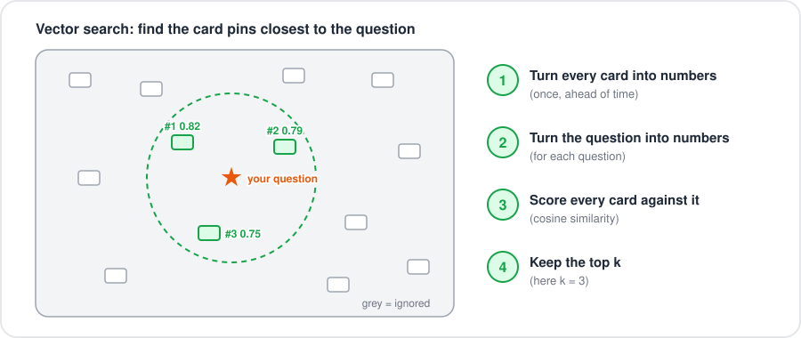

---
jupytext:
  text_representation:
    extension: .md
    format_name: myst
kernelspec:
  display_name: Python 3
  language: python
  name: python3
---

# Lesson 3 · Searching by meaning ("vector search")

> **In one sentence:** to search by meaning, turn the question into numbers too, compare it with
> every card's numbers, and pick the cards that score highest.

**Time:** about 35 minutes · **You will:** build the librarian's search step by step and write
the "pick the best few" part yourself.

---

## The idea in a picture

Remember the map of meaning from Lesson 2? Now imagine **every card in our library** is a pin on
that map. When a question arrives:

1. We place the question on the map as a new pin (we embed it).
2. We look at which card pins are **closest** to it.
3. We hand back the closest few - say 5. The number of cards to hand back is usually called **k**,
   so this is called **top-k** search.



*The question becomes a pin on the map; the librarian hands back the k cards closest to it.*

That's the whole idea. Search engines with millions of documents use clever tricks to be fast,
but they still do exactly this.

The word **vector** just means "a list of numbers" - so an embedding is a vector, and searching
with embeddings is called **vector search**.

---

## Step 1 · Turn every card into numbers (once)

The box below cuts the library into cards and embeds each card. This is the "build the library"
step - it happens once, ahead of time. (The result is saved, so the second time is instant.)

```{code-cell} ipython3
from raglab import load_documents, chunk_documents
from raglab.embeddings import get_embedder

docs = load_documents("python_docs")
cards = chunk_documents(docs, method="recursive", max_chars=800)

model = get_embedder()
card_vectors = model.embed_passages([c.text for c in cards])

print("Number of cards:", len(cards))
print("Shape of the numbers table:", card_vectors.shape)
print("Memory used:", round(card_vectors.nbytes / 1_000_000, 2), "MB")
```

**What you should see:** a table with one row per card and 384 columns. It's tiny in memory -
less than 1 MB. You could store tens of thousands of cards on a laptop without any problem.

## Step 2 · Score every card against a question

Now we embed a question and compute its similarity to **all** cards in one go.
`card_vectors @ question_vector` means "dot product of the question with every card" - and, as
you saw in Lesson 2, for these models that **is** the cosine similarity.

```{code-cell} ipython3
question = "How do I read command-line arguments in my script?"
question_vector = model.embed_query(question)

scores = card_vectors @ question_vector

print("We got one score per card:", len(scores), "scores")
print("Lowest score:", round(float(scores.min()), 3))
print("Highest score:", round(float(scores.max()), 3))
```

**What you should see:** one score for each card. Most are low (unrelated cards); a few are high.
Our job now: find **which** cards have the highest scores.

## Step 3 · Pick the best few ("top-k")

Imagine the scores are exam results for the whole class, and you want the names of the 3 best
students, best first. You need their **positions** in the list (so you can look up the names),
not just the scores.

Tiny example:

```text
scores:     [0.1, 0.9, 0.3, 0.7, 0.5]
positions:    0    1    2    3    4

best 3, best first -> positions [1, 3, 4]   (scores 0.9, 0.7, 0.5)
```

### ✏️ Exercise 3.1 · Write top-k

Write a function that returns the **positions** of the `k` highest scores, best first, as a list.

**Hints:**

- `np.argsort(scores)` returns the positions sorted from **lowest** to **highest** score.
  For the example above: `[0, 2, 4, 3, 1]`.
- You want the opposite order. Two easy ways: reverse it with `[::-1]`, or sort `-scores`
  (minus flips big and small).
- Then keep only the first `k` with `[:k]`. (If `k` is bigger than the list, `[:k]` simply
  returns everything - no special case needed.)
- Return a normal Python list of ints: `[int(i) for i in ...]`.

```{code-cell} ipython3
import numpy as np

def top_k(scores: np.ndarray, k: int) -> list[int]:
    # YOUR CODE HERE
    raise NotImplementedError
```

```{code-cell} ipython3
from raglab.checks import check_top_k
check_top_k(top_k)
```

Once it passes, use it to see the 3 best cards for our question:

```{code-cell} ipython3
try:
    for position in top_k(scores, 3):
        card = cards[position]
        print(f"score {scores[position]:.3f} | from {card.doc_id:18} | {card.text[:90]!r}")
except NotImplementedError:
    print("Finish exercise 3.1 first, then run this box again.")
```

**What you should see:** the best cards come from `py.argparse` - Python's tool for reading
command-line arguments. You just built a search engine from scratch!

---

## The ready-made librarian

Those three steps are packed into `VectorRetriever` (open `src/raglab/retrieval.py` in the file
panel and look for `class VectorRetriever` - it's only about 15 lines). Every librarian in this
course works the same way: you call `.search(question, k)` and get back the top `k` cards.

```{code-cell} ipython3
from raglab.retrieval import VectorRetriever
from raglab.display import hits_table

librarian = VectorRetriever(cards)
hits_table(librarian.search("How can I run code after a delay without blocking?", k=5))
```

---

## How good is our librarian? A first test

We have a list of 42 test questions. For each one, we wrote down which document contains the
answer - like an answer key for an exam. The box below asks the librarian every question and
counts how often the right document is among the top 5 cards. It also prints every **miss**.

```{code-cell} ipython3
from raglab import load_qa

questions = [q for q in load_qa("python_docs") if q["relevant_doc_ids"]]
correct = 0
for item in questions:
    found_docs = {card.doc_id for card in librarian.search(item["question"], k=5)}
    if found_docs & set(item["relevant_doc_ids"]):
        correct += 1
    else:
        print("MISSED:", item["question"], "| answer is in", item["relevant_doc_ids"])

print(f"\nThe right document was in the top 5 for {correct} of {len(questions)} questions.")
```

**What you should see:** most questions are answered well, plus a short list of misses.

```{admonition} The most useful habit in this whole course
:class: important
**Always read the misses.** A score like "38 out of 40" tells you *how much* went wrong.
The misses tell you *why*. Are they exact function names? Questions that need two documents?
That "why" tells you what to improve next.
```

---

## What about millions of cards?

Comparing the question to **every** card (as we did) is called **brute force**. It's perfectly
fine up to around a million cards on a normal computer.

For bigger libraries, special databases called **vector databases** (names you may hear: FAISS,
Qdrant, Milvus, pgvector) use shortcuts. A common one works like asking for directions in a
city: instead of checking every house, you hop from neighbourhood to neighbourhood, getting
closer each time. It's a tiny bit less exact, but thousands of times faster. The idea stays the
same: question in → closest cards out.

### ✏️ Exercise 3.2 · Does card size matter? (no checker)

In Lesson 1 we wondered which card size is best. Now you can test it!

1. In the box below, change `max_chars=800` to `300`, run it, and note the number.
2. Then try `1500`.
3. Which size gives the most correct answers here? Write one sentence on why a different set of
   documents might prefer a different size.

```{code-cell} ipython3
test_cards = chunk_documents(docs, method="recursive", max_chars=800)   # <- try 300 and 1500
test_librarian = VectorRetriever(test_cards)
score = sum(bool({c.doc_id for c in test_librarian.search(q["question"], k=5)} & set(q["relevant_doc_ids"]))
            for q in questions)
print(f"{len(test_cards)} cards -> {score} of {len(questions)} correct")
```

---

## Recap

- **Vector search** = turn the question into numbers, compare with every card, keep the top **k**.
- The heavy work (embedding all cards) happens once; each search is then very fast.
- Always **read the misses** - they show what to fix.

**Next lesson:** a second librarian who searches by exact **words** instead of meaning - and is
surprisingly good at the things this one gets wrong.

## Want to go deeper? (optional)

- *RAG_Techniques*: [simple_rag](https://github.com/NirDiamant/RAG_Techniques/blob/main/all_rag_techniques/simple_rag.ipynb)
  and [local_rag_huggingface_faiss](https://github.com/NirDiamant/RAG_Techniques/blob/main/all_rag_techniques/local_rag_huggingface_faiss.ipynb)
  do the same with the FAISS vector database · `references/NirDiamant_RAG_Techniques/all_rag_techniques/`
- *all-in-rag* (written in Chinese), chapter 3 on vector databases: `references/datawhalechina_all-in-rag/docs/chapter3/`
