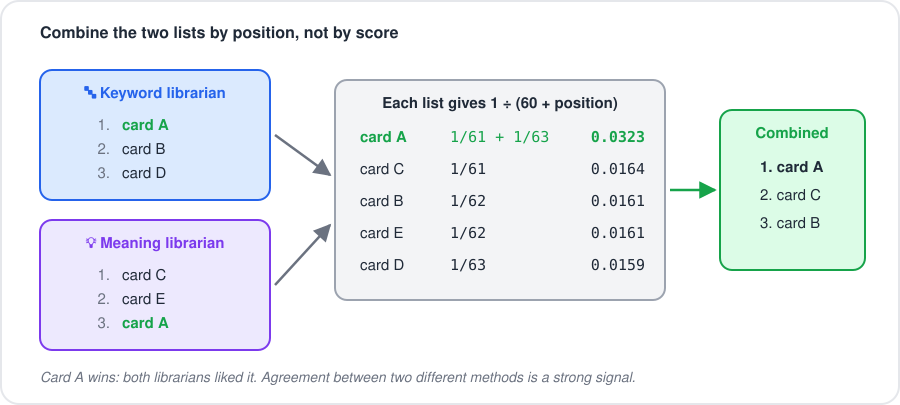

---
jupytext:
  text_representation:
    extension: .md
    format_name: myst
kernelspec:
  display_name: Python 3
  language: python
  name: python3
---

# Lesson 5 · Combining two searches ("hybrid search" with RRF)

> **In one sentence:** ask both librarians, then combine their top-lists by **rank** (1st, 2nd,
> 3rd...) instead of by score - cards that both of them like rise to the top.

**Time:** about 30 minutes · **You will:** see why mixing scores is unfair, and write the
simple voting rule that fixes it.

---

## Two experts, one decision

You now have two librarians:

- the **meaning librarian** (good with everyday wording),
- the **keyword librarian** (good with exact names).

Each gives you a ranked list of cards. How do you combine them into one list?

### Why we can't just add the scores

Run the box below. It asks both librarians the same question and prints their scores.

```{code-cell} ipython3
from raglab import load_documents, chunk_documents
from raglab.retrieval import BM25Retriever, VectorRetriever

cards = chunk_documents(load_documents("python_docs"), "recursive", max_chars=800)
keyword_librarian = BM25Retriever(cards)
meaning_librarian = VectorRetriever(cards)

question = "How do I remove a directory tree?"
print("Keyword scores:", [round(c.score, 2) for c in keyword_librarian.search(question, 5)])
print("Meaning scores:", [round(c.score, 2) for c in meaning_librarian.search(question, 5)])
```

**What you should see:** keyword scores like 10, 15 or 25; meaning scores between about 0.5 and 0.9.

It's like two judges at a talent show: one gives marks **out of 100**, the other gives
**1 to 5 stars**. If you simply add the marks together, the out-of-100 judge decides everything,
and the star judge might as well not be there.

## The fix: only look at the positions

Instead of scores, look at **who came 1st, 2nd, 3rd** in each list. That's fair, because
positions mean the same thing for both judges.

The rule is called **Reciprocal Rank Fusion (RRF)**. "Reciprocal" just means "1 divided by".
Every list gives each card a small number of points:

$$\text{points} = \frac{1}{60 + \text{position}}$$

and each card's points from all lists are added up. A worked example:

| Card | position in keyword list | position in meaning list | total points |
|---|---|---|---|
| A | 1st | 3rd | 1/61 + 1/63 = **0.0323** |
| B | 2nd | (not in list) | 1/62 = 0.0161 |
| C | (not in list) | 1st | 1/61 = 0.0164 |

Card **A** wins - not because it was first anywhere special, but because **both** librarians
put it near the top. That's exactly what we want: agreement between two very different methods
is a strong signal.



*The same example as a picture: each list votes by position, and the votes are added up.*

**Why the 60?** It's a "calming" number. Without it, 1st place would get 1/1 = 1 point and
2nd place 1/2 = 0.5 - a huge gap. With 60, 1st gets 1/61 and 2nd gets 1/62 - nearly the same.
So no single list can bully the result. 60 is simply the value the original researchers found
worked well; it's usually called **k** in the formula.

### ✏️ Exercise 5.1 · Write the voting rule

Your function receives several ranked lists of card IDs, best first, for example:

```python
[["a", "b", "c"],    # list from librarian 1
 ["c", "a", "d"]]    # list from librarian 2
```

It must return a dictionary `{card_id: total_points}`.

**Step-by-step hints:**

1. Start with an empty dictionary: `points = {}`.
2. Loop over the lists: `for ranking in rankings:`
3. Inside, loop over cards **with their position, starting at 1**:
   `for position, card_id in enumerate(ranking, start=1):`
4. Add this list's vote: `points[card_id] = points.get(card_id, 0) + 1 / (k + position)`
   (`points.get(card_id, 0)` means "the points so far, or 0 if this card is new").
5. `return points`

```{code-cell} ipython3
def reciprocal_rank_fusion(rankings: list[list[str]], k: int = 60) -> dict[str, float]:
    # YOUR CODE HERE
    raise NotImplementedError
```

```{code-cell} ipython3
from raglab.checks import check_rrf
check_rrf(reciprocal_rank_fusion)
```

---

## The combined ("hybrid") librarian

`HybridRetriever` asks each librarian for their top 30, combines them with RRF, and hands back
the best `k`. Using two different search methods together is called **hybrid search**.

```{code-cell} ipython3
from raglab.retrieval import HybridRetriever
from raglab.display import hits_table

hybrid_librarian = HybridRetriever([keyword_librarian, meaning_librarian])
hits_table(hybrid_librarian.search(question, 5))
```

**What you should see:** the scores are now small RRF points (around 0.03). Only their order matters.

## Did combining actually help?

Let's test all three librarians on the 40 answerable test questions. We'll explain these
numbers properly in Lesson 8. For now, all you need:

- **recall@5** - how often the right document is in the top 5 (1.0 = always).
- **mrr** - how high up the right document usually is (1.0 = always in 1st place, 0.5 = usually 2nd).
- **ms** - milliseconds per question (lower = faster).

```{code-cell} ipython3
import pandas as pd
from raglab import load_qa
from raglab.evaluation import evaluate_retriever, summarize

test_questions = load_qa("python_docs")
results = pd.concat([
    evaluate_retriever(keyword_librarian, test_questions, k=5, name="keywords only"),
    evaluate_retriever(meaning_librarian, test_questions, k=5, name="meaning only"),
    evaluate_retriever(hybrid_librarian, test_questions, k=5, name="hybrid (both)"),
])
summarize(results)
```

**What you should see:** the hybrid librarian usually has the best (or close to the best)
recall. It may not win on every number - and that's fine.

Now look at individual questions where the hybrid result is **different** from the best single
librarian. This tells you when combining helped and when it hurt:

```{code-cell} ipython3
per_question = results.pivot_table(index="question", columns="system", values="mrr")
best_single = per_question[["keywords only", "meaning only"]].max(axis=1)
per_question[per_question["hybrid (both)"] != best_single]
```

### ✏️ Exercise 5.2 · Trust one librarian more (no checker)

Sometimes one librarian deserves more say. Write a new version of your function that takes a
`weights` list, so each list's vote becomes `weight / (k + position)`. For example
`weights=[0.7, 0.3]` gives the first list more say.

Try a few weights on one or two questions. **Careful:** if you choose weights by looking at our
test questions and then report the score on those same questions, you're cheating a little -
like a student who sees the exam before taking it. Lesson 8 explains how to avoid this.

```{code-cell} ipython3
# YOUR CODE HERE
```

---

## Common mix-ups

- **"RRF scores tell you how good a card is."** No - they only tell you the order. Don't compare
  them with cosine or BM25 scores.
- **"Hybrid is always better."** It's better *on average* and rarely terrible, which makes it a
  great default. On some questions, one librarian alone would have done better.

## Recap

- Scores from different methods aren't comparable - like marks out of 100 vs. stars out of 5.
- **RRF** combines lists using only positions: each list gives `1 / (60 + position)` points.
- Cards that **both** librarians like rise to the top.

**Next lesson:** a third, slower but more careful expert who double-checks the shortlist.

## Want to go deeper? (optional)

- *RAG_Techniques* [fusion_retrieval](https://github.com/NirDiamant/RAG_Techniques/blob/main/all_rag_techniques/fusion_retrieval.ipynb) · `references/NirDiamant_RAG_Techniques/all_rag_techniques/`
- *RAG from scratch*, videos 5-9 (they use RRF to combine several searches): `references/langchain-ai_rag-from-scratch/rag_from_scratch_5_to_9.ipynb`
- The original RRF paper: Cormack, Clarke & Büttcher (2009).
