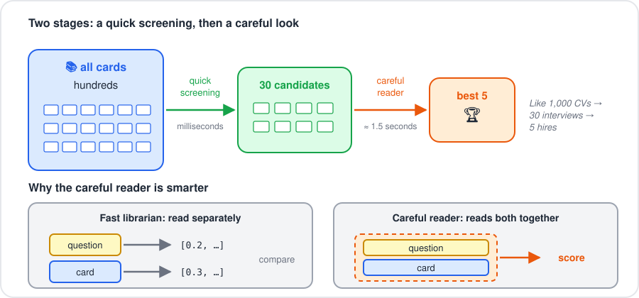

---
jupytext:
  text_representation:
    extension: .md
    format_name: myst
kernelspec:
  display_name: Python 3
  language: python
  name: python3
---

# Lesson 6 · A careful second look ("re-ranking")

> **In one sentence:** first grab about 30 possibly-useful cards quickly, then let a slower but
> smarter model read each one **together with the question** and put the best ones on top.

**Time:** about 35 minutes · **You will:** add a "careful reader" step and measure how much
better - and how much slower - it makes the search.

---

## The job interview analogy

A company gets 1,000 job applications. Nobody interviews 1,000 people. Instead:

1. **Quick screening:** HR skims every CV for a few seconds and picks the 30 most promising.
   Fast, but rough.
2. **Interviews:** a manager talks to those 30 people properly - one at a time, really
   understanding each one - and picks the best 5.

Our search can work the same way:

| Stage | In the job example | In our RAG system | Speed |
|---|---|---|---|
| 1. Quick screening | HR skims all CVs | the hybrid librarian finds ~30 candidate cards | very fast |
| 2. Careful interviews | manager interviews 30 people | a **re-ranker** reads each of the 30 cards with the question | slower |

Stage 2 is called **re-ranking** - putting the shortlist in a new, better order.



*Top: the two stages. Bottom: why reading question and card together is more accurate (and slower).*

## Why is the second model smarter?

Our meaning librarian (Lessons 2-3) turns the question and each card into numbers
**separately**, then compares the numbers. It's like judging whether two people would get along
by comparing their written profiles - **without them ever meeting**. That's why it can be fast:
the cards' numbers are calculated once, in advance.

A **re-ranker** reads the question and the card **together, at the same time**, like an actual
conversation. It can notice details such as:

- the question says *"does **not** block"* but the card describes something that **does** block;
- the card mentions the right word, but in a different context.

The price: it has to read every (question, card) pair fresh, every time. That's far too slow
for a whole library - but fine for 30 cards.

*(You may meet the technical names: the fast "separate" model is called a **bi-encoder**, and the
careful "together" model is a **cross-encoder**.)*

---

## Try it

Our re-ranker is a small model called `ms-marco-MiniLM-L-6-v2`. It was trained on real search
questions from the Bing search engine, paired with web pages people found helpful.

The box below:
1. builds the hybrid librarian from Lesson 5,
2. asks it for 30 candidates,
3. shows the top 5 **before** and **after** re-ranking.

```{code-cell} ipython3
from raglab import load_documents, chunk_documents
from raglab.retrieval import BM25Retriever, VectorRetriever, HybridRetriever
from raglab.rerank import CrossEncoderReranker, RerankingRetriever
from raglab.display import hits_table

cards = chunk_documents(load_documents("python_docs"), "recursive", max_chars=800)
hybrid_librarian = HybridRetriever([BM25Retriever(cards), VectorRetriever(cards)])
careful_reader = CrossEncoderReranker()

question = "How do I limit how many coroutines run at the same time?"
candidates = hybrid_librarian.search(question, 30)

print("BEFORE re-ranking (hybrid librarian's top 5):")
display(hits_table(candidates[:5]))
print("AFTER re-ranking (careful reader's top 5):")
display(hits_table(careful_reader.rerank(question, candidates, 5)))
```

**What you should see:** the right answer lives in `py.asyncio.locks` (a tool called
`Semaphore`, which works like a nightclub bouncer letting only N people in at once).

- **Before** re-ranking, `py.asyncio.locks` is probably **not even in the top 5** - the hybrid
  librarian is distracted by cards that share words like *coroutines* and *time*.
- **After** re-ranking, it should jump to **1st place**. It was in the 30-card shortlist all
  along; the careful reader recognised it as the real answer.

(You'll meet this exact question again in Lesson 7, where the writer fails on it *because* the
right card wasn't in the top few. Re-ranking is one way to fix that.)

```{admonition} Why are some scores negative?
:class: note
The re-ranker's scores aren't percentages or similarities - they're raw "how relevant" numbers
that can be any size, positive or negative. Only the **order** matters: higher = more relevant.
```

---

## Is it worth it? Let's measure

The box below tests the hybrid librarian with and without the re-ranker on all test questions.
Pay attention to two columns:

- **mrr** - higher means the right document is closer to the top,
- **ms** - milliseconds per question. This is the cost.

This box takes about a minute, because the re-ranker reads 30 cards for each of the 40 questions.

```{code-cell} ipython3
import pandas as pd
from raglab import load_qa
from raglab.evaluation import evaluate_retriever, summarize

test_questions = load_qa("python_docs")
with_reranker = RerankingRetriever(hybrid_librarian, careful_reader, candidates=30)
results = pd.concat([
    evaluate_retriever(hybrid_librarian, test_questions, 5, "hybrid"),
    evaluate_retriever(with_reranker, test_questions, 5, "hybrid + re-ranker"),
])
summarize(results)
```

**What you should see:** the re-ranker improves **mrr** (the right card moves up), but **ms**
goes from about 15 to well over 1,000 - roughly a hundred times slower. Better answers vs. slower
answers: that trade-off is a real decision you'd make in a real project. (With a graphics card
the re-ranker would be much faster.)

### ✏️ Exercise 6.1 · How long should the shortlist be? (no checker)

The careful reader can only re-order what the quick screening found. If the right card isn't in
the shortlist, no amount of careful reading will find it.

1. In the box below, change `candidates=30` to `5`, then `10`, then `60`.
2. Note the **mrr** and **ms** each time.
3. Where does making the shortlist longer stop helping?

```{code-cell} ipython3
test = RerankingRetriever(hybrid_librarian, careful_reader, candidates=30)   # <- try 5, 10, 60
summarize(evaluate_retriever(test, test_questions, 5, "test"))
```

### ✏️ Exercise 6.2 · When does the careful reader get it wrong? (no checker)

The box below lists questions where the re-ranker did **worse** than the hybrid librarian alone.
Read those questions and their cards. Remember: the re-ranker learned from **web search**
questions. Can you guess why programming documentation might sometimes confuse it?

```{code-cell} ipython3
per_question = results.pivot_table(index="question", columns="system", values="mrr")
per_question[per_question["hybrid + re-ranker"] < per_question["hybrid"]]
```

---

## Common mix-ups

- **"The re-ranker searches the library."** It doesn't - it only re-orders the shortlist it is
  given. Finding candidates is still the librarian's job.
- **"Always re-rank."** Only if your system can afford the extra time (and cost, if you pay for
  a hosted re-ranker). Measure first.

## Recap

- **Two stages:** a fast librarian picks ~30 candidates; a slow, careful re-ranker picks the best 5.
- The re-ranker is smarter because it reads the question and card **together**.
- It improves the order at the top, but costs a lot of time, and can't rescue a card that was
  never in the shortlist.

**Next lesson:** the writer - turning the best cards into an honest answer with footnotes.

## Want to go deeper? (optional)

- *RAG_Techniques* [reranking](https://github.com/NirDiamant/RAG_Techniques/blob/main/all_rag_techniques/reranking.ipynb)
  (also shows using a large AI model as the re-ranker) · `references/NirDiamant_RAG_Techniques/all_rag_techniques/reranking.ipynb`
- The winning system of the *Enterprise RAG Challenge 2* used AI re-ranking - read how in
  `references/IlyaRice_RAG-Challenge-2/README.md`
