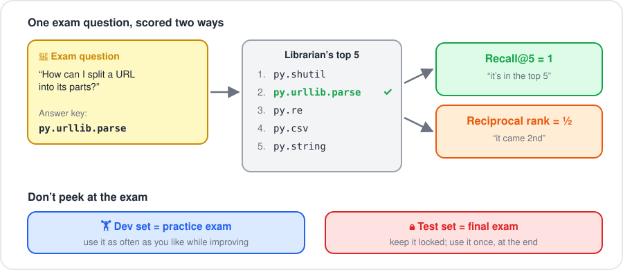

---
jupytext:
  text_representation:
    extension: .md
    format_name: myst
kernelspec:
  display_name: Python 3
  language: python
  name: python3
---

# Lesson 8 · Grading the system ("evaluation")

> **In one sentence:** instead of trying a few questions and going "looks good", we give the system
> a proper exam with an answer key, score it with simple numbers, and study the questions it got wrong.

**Time:** about 60 minutes · **You will:** write two scoring rules yourself, build a leaderboard of
every librarian from this course, and learn how to avoid fooling yourself.

---

## Why "it looks good" isn't good enough

Imagine you're a cooking teacher deciding whether a new recipe is better. You taste one spoonful
and say "yes, better!" But maybe you were just hungry. Maybe that spoonful happened to have the
most cheese. To really know, you'd have several people taste several dishes, and write down
their scores.

RAG systems are the same. Every change - card size, a new librarian, new rules for the writer -
helps some questions and hurts others. Only a proper test tells you if the overall result got
**better**, **worse**, or just **different**.

We grade two separate things:

| What we grade | Question we ask | How |
|---|---|---|
| **The librarian** | Did it bring the right cards? | Easy: compare with an answer key of "which document answers this" |
| **The writer** | Is the final answer correct and backed by the cards? | Harder: a human or another AI reads it |

**Always grade the librarian first.** If the right card wasn't brought, no writer can save the answer.

---

## The exam: our question set

We have 42 questions. For each one, we wrote down which document contains the answer (the
answer key) and the exact sentence that answers it. Two questions are deliberately impossible
to answer from our library (to test that the system says "I don't know").

```{code-cell} ipython3
import pandas as pd
from raglab import load_qa

exam = load_qa("python_docs")
pd.DataFrame(exam)[["qid", "category", "question", "relevant_doc_ids"]].head(8)
```

**What you should see:** questions with an ID, a type (category), and the correct document(s).

```{admonition} Making your own exam (for your own projects)
:class: tip
Collect questions **real users actually ask**. For each, note which document answers it.
Include tricky ones: questions needing two documents, and questions your documents can't answer.
30-50 well-chosen questions are already very useful.
```

---



*One question, two scores - and the golden rule of not peeking at the final exam. Each part is explained below.*

---

## Score 1 · "Did it find it?" (Recall@k)

**Recall@k** asks: *of the documents needed to answer, how many are in the top k results?*

- Question needs document A. Top 5 contains A → recall = 1 (found everything).
- Question needs documents A **and** B. Top 5 contains only A → recall = 1/2 = 0.5.
- Top 5 contains neither → recall = 0.

It's like checking a shopping trip: you needed eggs and milk, you came home with eggs → you got
half of what you needed.

### ✏️ Exercise 8.1 · Write Recall@k

You get `retrieved` (the documents found, best first), `relevant` (the answer key) and `k`.

**Hints:**

1. Keep only the first `k` results: `retrieved[:k]`.
2. Find which relevant documents are among them. Python sets make this easy:
   `set(retrieved[:k]) & set(relevant)` gives the overlap.
3. Return `len(overlap) / len(set(relevant))`.

```{code-cell} ipython3
def recall_at_k(retrieved: list[str], relevant: list[str], k: int) -> float:
    # YOUR CODE HERE
    raise NotImplementedError
```

```{code-cell} ipython3
from raglab.checks import check_recall_at_k
check_recall_at_k(recall_at_k)
```

## Score 2 · "How high up was it?" (MRR)

Recall only says *whether* the document was found. But 1st place is much better than 5th - the
writer pays most attention to the first cards, and you'd rather it didn't have to dig.

**Reciprocal rank** = 1 divided by the position of the first correct document:

| First correct document at | Score |
|---|---|
| position 1 | 1/1 = **1.0** |
| position 2 | 1/2 = **0.5** |
| position 3 | 1/3 = **0.33** |
| not found | **0** |

Averaged over all questions, this is called **MRR** (*Mean Reciprocal Rank*). An MRR of 0.9
means "the right document is almost always first".

### ✏️ Exercise 8.2 · Write reciprocal rank

**Hints:** loop over `retrieved` with positions starting at 1
(`for position, doc_id in enumerate(retrieved, start=1):`). As soon as `doc_id` is in
`relevant`, `return 1 / position`. If the loop finishes without finding one, `return 0.0`.

```{code-cell} ipython3
def reciprocal_rank(retrieved: list[str], relevant: list[str]) -> float:
    # YOUR CODE HERE
    raise NotImplementedError
```

```{code-cell} ipython3
from raglab.checks import check_mrr
check_mrr(reciprocal_rank)
```

---

## The leaderboard: every librarian you've built

Now we run the exam for everything from Lessons 1-6: two ways of cutting cards × three
librarians, plus the re-ranker. This box takes about 1-2 minutes.

```{code-cell} ipython3
from raglab import load_documents, chunk_documents
from raglab.retrieval import BM25Retriever, VectorRetriever, HybridRetriever
from raglab.rerank import RerankingRetriever
from raglab.evaluation import evaluate_retriever, summarize

docs = load_documents("python_docs")
systems = {}
for cutting, settings in [("fixed", dict(size=500, overlap=100)), ("recursive", dict(max_chars=800))]:
    cards = chunk_documents(docs, cutting, **settings)
    keywords, meaning = BM25Retriever(cards), VectorRetriever(cards)
    systems[f"{cutting} cards | keywords"] = keywords
    systems[f"{cutting} cards | meaning"] = meaning
    systems[f"{cutting} cards | hybrid"] = HybridRetriever([keywords, meaning])
systems["recursive cards | hybrid + re-ranker"] = RerankingRetriever(systems["recursive cards | hybrid"])

results = pd.concat([evaluate_retriever(r, exam, k=5, name=name) for name, r in systems.items()])
summarize(results).sort_values("mrr", ascending=False)
```

**How to read the table:**

- **recall@5** - how often the right document was in the top 5 (1.0 = always).
- **mrr** - how high up it usually was (1.0 = always first).
- **ndcg@5** - similar to mrr, but also gives credit when a question needs several documents and
  more of them are near the top. Read it like mrr: higher is better.
- **ms** - milliseconds per question.

### Is the difference real, or luck?

With only 40 questions, **one** question changing from 2nd to 1st place moves MRR by about 0.0125.
So small differences may just be luck. Before believing "A is better than B", count how many
questions actually changed:

```{code-cell} ipython3
per_question = results.pivot_table(index="qid", columns="system", values="mrr")
a, b = "recursive cards | hybrid + re-ranker", "recursive cards | hybrid"
print(f"'{a}' was better on {(per_question[a] > per_question[b]).sum()} questions, "
      f"worse on {(per_question[a] < per_question[b]).sum()}, "
      f"and the same on {(per_question[a] == per_question[b]).sum()}.")
```

**What you should see:** most questions are tied. The difference comes from only a handful.
That's normal - and a reason to be modest about small improvements.

```{admonition} Don't peek at the exam (dev set vs. test set)
:class: warning
If you keep adjusting your system while looking at the same exam questions, you'll slowly
"learn the exam" - the score goes up, but real users won't see the improvement. It's like a
student who memorises last year's test.

The fix: split your questions in two. Use the **dev set** ("practice exam") while you're making
changes. Keep the **test set** ("final exam") locked away and use it **once**, at the end.
```

---

## Studying the mistakes

Numbers tell you **how much** went wrong; the mistakes tell you **why**. The box below shows the
best system's average scores per question type, then lists every question it didn't fully solve:

```{code-cell} ipython3
best = results[results.system == "recursive cards | hybrid + re-ranker"]
print(best.groupby("category")[["recall@5", "mrr"]].mean().round(2))
best[best["recall@5"] < 1][["qid", "category", "question", "retrieved"]]
```

If the list is empty, the librarian found every needed document - our exam may simply be too
easy. (Exercise 8.3 lets you test that.)

---

## Grading the writer: let another AI be the examiner

Even with perfect cards, the writer can still get things wrong - misread a card, or add facts
that aren't on any card. Checking hundreds of answers by hand is slow, so a common trick is to
ask **another AI call** to act as the examiner. This is called **LLM-as-judge**.

We give the judge the cards and the answer and ask: *is every fact in the answer backed by
the cards?* It replies **SUPPORTED**, **PARTIAL** or **UNSUPPORTED**. Being backed by the cards is
often called **faithfulness** or **groundedness**.

The box below answers 8 questions and has each one judged (about 16 AI calls):

```{code-cell} ipython3
from raglab import llm
from raglab.rag import SimpleRAG, format_context
from raglab.evaluation import judge_faithfulness

if llm.llm_available():
    rag = SimpleRAG(systems["recursive cards | hybrid + re-ranker"], k=4)
    rows = []
    for item in [q for q in exam if q["relevant_doc_ids"]][:8]:
        out = rag.ask(item["question"])
        verdict = judge_faithfulness(out.answer, format_context(out.hits))
        rows.append({"question": item["question"], "answer": out.answer[:120],
                     "judge says": verdict["verdict"],
                     "cited the right document": bool(set(out.cited_doc_ids) & set(item["relevant_doc_ids"]))})
    display(pd.DataFrame(rows))
else:
    print(llm.explain_setup())
```

**Important:** AI judges make mistakes too. Read a few of their verdicts yourself before trusting them.

### ✏️ Exercise 8.3 · Write your own exam questions (no checker)

Our 42 questions were written by looking at the documents - which can make them easier than
real users' questions. Test that:

1. Open `data/python_docs/documents.jsonl` (in the file panel) and pick two topics you find
   interesting.
2. Write 5 questions the way a **real person** would ask them - including one that needs **two**
   documents and one that the library **can't** answer.
3. Fill them into the list below and run it. Is the score as good as on our exam? If not, why?

```{code-cell} ipython3
my_exam = [
    # {"qid": "ME-1", "question": "how do I wrap long text to 40 characters per line?",
    #  "relevant_doc_ids": ["py.textwrap"], "category": "paraphrase"},
]
if my_exam:
    display(summarize(evaluate_retriever(systems["recursive cards | hybrid + re-ranker"], my_exam, 5, "my exam")))
```

---

## Common mix-ups

- **"A higher number means it's better for users."** Only if the exam reflects what users really ask.
- **"0.93 vs 0.94 - B wins!"** With 40 questions, that's probably luck. Count wins and losses per question.
- **"The AI judge is always right."** It's a helpful assistant, not the truth. Spot-check it.

## Recap

- Grade the **librarian** first (Recall@k, MRR), then the **writer** (human or AI judge).
- **Recall@k:** did the needed documents make the top k? **MRR:** how high up was the first one?
- Small differences on small exams are often luck - count questions won and lost.
- Keep a **test set** you don't look at while making changes.
- The mistakes, grouped by type, tell you what to work on next.

**Next lesson:** advanced trick #1 - let the AI improve the question before searching.

## Want to go deeper? (optional)

- *rag-zero-to-hero-guide*, "RAG Evaluation" section: `references/KalyanKS-NLP_rag-zero-to-hero-guide/RAG Evaluation/`
- *all-in-rag* (written in Chinese) has a chapter on evaluation: `references/datawhalechina_all-in-rag/docs/`
- Popular evaluation toolkits to look at next: **RAGAS**, **DeepEval**, **TruLens**.
