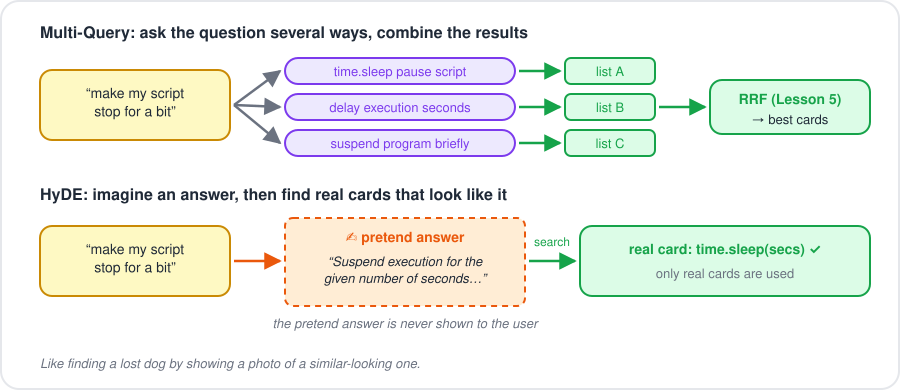

---
jupytext:
  text_representation:
    extension: .md
    format_name: myst
kernelspec:
  display_name: Python 3
  language: python
  name: python3
---

# Lesson 9 · Improving the question before searching

> **In one sentence:** people ask short, vague or oddly-worded questions - so before searching,
> we let the AI rephrase the question (or even imagine the answer), and search with that instead.

**Time:** about 45 minutes · **Needs:** the AI writer · **You will:** try two popular tricks,
*Multi-Query* and *HyDE*, and measure whether they're worth their cost.

---

## The problem: people don't talk like documentation

A real user types: *"how do I make my script stop for a bit"*.
The documentation says: *"Delay execution for a given number of seconds."*

They mean the same thing, but share almost no words. In Lesson 4 you fixed this **by hand** -
you rewrote the question using the documentation's words. Now we'll let the AI do it.

Think of a good reference librarian in a real library. When a visitor asks a vague question,
the librarian doesn't search for those exact words. They think: *"what would the book about this
call it?"* and search for that. That's what these tricks do.

| Trick | What the AI does | Everyday version |
|---|---|---|
| **Rewriting** | rephrases the question in the documents' style | "you mean *sleep* - let me look that up" |
| **Multi-Query** | writes **several** versions of the question, searches each, combines the results | asking three librarians to each search in their own way |
| **HyDE** | writes a **made-up answer**, then searches for real cards that look like it | "I don't know the answer, but I know roughly what it would look like" |



*Top: Multi-Query searches with several rewrites and combines the lists. Bottom: HyDE searches with an imagined answer.*

First, set up the librarians from earlier lessons:

```{code-cell} ipython3
import pandas as pd
from raglab import llm, load_documents, load_qa, chunk_documents
from raglab.retrieval import BM25Retriever, VectorRetriever, HybridRetriever, Hit, reciprocal_rank_fusion
from raglab.evaluation import evaluate_retriever, summarize

cards = chunk_documents(load_documents("python_docs"), "recursive", max_chars=800)
meaning_librarian = VectorRetriever(cards)
hybrid_librarian = HybridRetriever([BM25Retriever(cards), meaning_librarian])
exam = load_qa("python_docs")
print("Writer connected:", llm.llm_available())
```

---

## Trick 1 · Multi-Query: ask the question several ways

We ask the AI to write 3 different search queries for the same question. Then we search with
**each one** and combine the result lists using RRF from Lesson 5 - cards that show up in
several lists rise to the top.

First, see what the AI writes:

```{code-cell} ipython3
MULTI_QUERY_PROMPT = """Write 3 different search queries that would find documentation answering
the user's question. Use technical Python terms where helpful. One query per line, no numbering.

Question: {question}"""

def multi_query(question: str) -> list[str]:
    reply = llm.chat(MULTI_QUERY_PROMPT.format(question=question), temperature=0.3)
    variants = [line.strip("-• ").strip() for line in reply.splitlines() if line.strip()]
    return [question] + variants[:3]          # keep the original question too

if llm.llm_available():
    for version in multi_query("how do I make my script stop for a bit"):
        print("•", version)
```

**What you should see:** the original question plus 3 rewrites using words like *sleep*,
*delay* or *pause execution* - the vocabulary the documentation actually uses.

Now a librarian that uses this: for each version, search; then combine with RRF.

```{code-cell} ipython3
class MultiQueryLibrarian:
    def __init__(self, librarian, candidates: int = 20):
        self.librarian, self.candidates = librarian, candidates

    def search(self, question: str, k: int = 5) -> list[Hit]:
        cards_by_id, ranked_lists = {}, []
        for version in multi_query(question):                     # 1. several versions
            found = self.librarian.search(version, self.candidates)  # 2. search each one
            ranked_lists.append([c.chunk.chunk_id for c in found])
            cards_by_id.update({c.chunk.chunk_id: c.chunk for c in found})
        combined = reciprocal_rank_fusion(ranked_lists)            # 3. combine with RRF
        best = sorted(combined.items(), key=lambda item: -item[1])[:k]
        return [Hit(cards_by_id[cid], points, rank) for rank, (cid, points) in enumerate(best, 1)]
```

---

## Trick 2 · HyDE: imagine the answer, then search for it

Here's a clever observation: a **question** and its **answer** look very different, but an
**answer** and **another answer** look alike. So:

1. Ask the AI to write a short, *pretend* answer in the style of the documentation.
   (It might even contain mistakes - that's okay!)
2. Turn that pretend answer into numbers and search for **real** cards near it.
3. Throw the pretend answer away. Only real cards are used.

It's like looking for a lost dog: instead of describing it in words, you hold up a photo of a
similar-looking dog and ask *"seen one like this?"*

HyDE stands for **Hy**pothetical **D**ocument **E**mbeddings - "hypothetical" meaning "imagined".

```{code-cell} ipython3
HYDE_PROMPT = """Write a short passage (2-3 sentences) from the Python standard library
documentation that answers the question. Write it in the style of a docstring.

Question: {question}"""

if llm.llm_available():
    print(llm.chat(HYDE_PROMPT.format(question="how do I make my script stop for a bit")))
```

**What you should see:** a short, documentation-style paragraph about `time.sleep` - which looks
a lot like the real card we want to find.

```{code-cell} ipython3
class HyDELibrarian:
    def __init__(self, meaning_librarian):
        self.librarian = meaning_librarian

    def search(self, question: str, k: int = 5) -> list[Hit]:
        pretend_answer = llm.chat(HYDE_PROMPT.format(question=question))
        # The pretend answer is a *passage*, so we embed it like a card, not like a question:
        vector = self.librarian.embedder.embed_passages([pretend_answer], use_cache=False)[0]
        scores = self.librarian.vectors @ vector
        best = scores.argsort()[::-1][:k]
        return [Hit(self.librarian.chunks[i], float(scores[i]), rank) for rank, i in enumerate(best, 1)]
```

---

## Are they worth it? Let's measure

This box runs the full exam for four librarians. The two new ones call the AI for **every**
question, so it takes a few minutes (about 80 AI calls).

```{code-cell} ipython3
if llm.llm_available():
    results = pd.concat([
        evaluate_retriever(meaning_librarian, exam, 5, "meaning"),
        evaluate_retriever(hybrid_librarian, exam, 5, "hybrid"),
        evaluate_retriever(HyDELibrarian(meaning_librarian), exam, 5, "HyDE (meaning)"),
        evaluate_retriever(MultiQueryLibrarian(hybrid_librarian), exam, 5, "multi-query (hybrid)"),
    ])
    display(summarize(results))
```

**What you should see:** the tricks usually push **mrr** up. Now look at the **ms** column: each
question now takes **seconds** instead of milliseconds, because the AI must answer *before* the
search can even start. Better results vs. waiting time (and AI cost) - again a trade-off you
have to decide on.

### ✏️ Exercise 9.1 · Split a two-part question (no checker)

Some questions need **two** documents, like *"How do I compress data with gzip and then encode
the result as base64 text?"* - one part is about `gzip`, the other about `base64`. A single
search often finds only one of them.

Build a `SplittingLibrarian` that:

1. asks the AI to split the question into simple sub-questions, one per line
   (example prompt: *"Split the question into independent sub-questions, one per line. If it is
   already simple, repeat it."*),
2. searches for each sub-question,
3. combines the cards (skip duplicates) and returns the top `k`.

Test it only on the two-document questions:
`[q for q in exam if q["category"] == "multi_hop"]`. Does it beat the hybrid librarian?
(One possible answer is on the Solutions page.)

```{code-cell} ipython3
# YOUR CODE HERE
```

---

## Common mix-ups

- **"HyDE shows the made-up answer to the user."** Never - it's only used to *find* real cards.
- **"More AI steps = better."** Each step adds waiting time and cost. Only keep a trick if your
  measurements show it's worth it **for your users' questions**.

## Recap

- Users' words often don't match the documents' words.
- **Multi-Query:** search with several rewrites, combine with RRF.
- **HyDE:** search with an imagined answer instead of the question.
- Both usually help, but make every question take seconds instead of milliseconds.

**Next lesson:** a system that checks its own cards - and can decide to search again.

## Want to go deeper? (optional)

- *RAG_Techniques*: [query_transformations](https://github.com/NirDiamant/RAG_Techniques/blob/main/all_rag_techniques/query_transformations.ipynb),
  [HyDe](https://github.com/NirDiamant/RAG_Techniques/blob/main/all_rag_techniques/HyDe_Hypothetical_Document_Embedding.ipynb),
  [HyPE](https://github.com/NirDiamant/RAG_Techniques/blob/main/all_rag_techniques/HyPE_Hypothetical_Prompt_Embeddings.ipynb) ·
  `references/NirDiamant_RAG_Techniques/all_rag_techniques/`
- *RAG from scratch*, videos 5-9 (Multi-Query, splitting questions, HyDE): `references/langchain-ai_rag-from-scratch/rag_from_scratch_5_to_9.ipynb`
