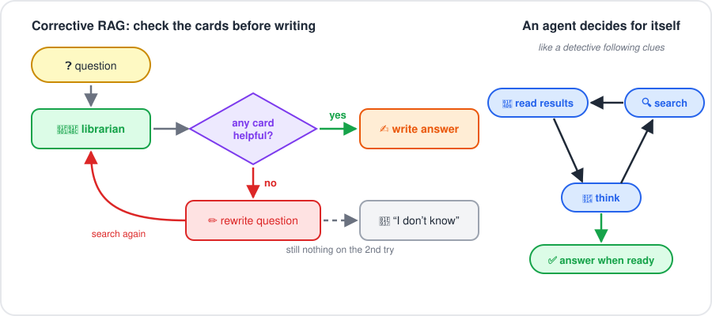

---
jupytext:
  text_representation:
    extension: .md
    format_name: myst
kernelspec:
  display_name: Python 3
  language: python
  name: python3
---

# Lesson 10 · A system that checks its own work (and where to go next)

> **In one sentence:** instead of blindly trusting the librarian, the system checks whether the
> cards are actually useful - and if not, it searches again or honestly gives up.

**Time:** about 60 minutes · **Needs:** the AI writer · **You will:** build a self-checking RAG
system, then a tiny "agent" that decides for itself when to search - and get a map of advanced
techniques to explore next.

---

## The problem with a straight line

Until now, our system has been a straight line:

```text
question ──► librarian finds cards ──► writer answers
```

It never stops to ask *"are these cards any good?"* If the librarian brings rubbish, the writer
either refuses (good) or - worse - tries to answer from rubbish.

A careful human researcher works differently. They look at what they found, think *"this isn't
quite it"*, try a different search, and only write once they have good material. The newest RAG
techniques add exactly these **decisions** to the line.

---

## Part 1 · Corrective RAG ("check the cards first")

This idea comes from a 2024 research paper called **CRAG** (*Corrective* RAG). We'll build a
simplified version:



*Left: check the cards, retry once, otherwise say "I don't know" (Part 1). Right: an agent that loops until it's ready (Part 2).*

Like a student writing an essay: they check each book from the library, keep the useful ones,
and if none were useful, they go back with a better search term. If there's still nothing, they
say so honestly instead of making something up.

Set up the librarian first:

```{code-cell} ipython3
from raglab import llm, load_documents, chunk_documents
from raglab.retrieval import BM25Retriever, VectorRetriever, HybridRetriever
from raglab.rag import SYSTEM_PROMPT, build_prompt

cards = chunk_documents(load_documents("python_docs"), "recursive", max_chars=800)
librarian = HybridRetriever([BM25Retriever(cards), VectorRetriever(cards)])
print("Writer connected:", llm.llm_available())
```

### Step 1 · The card checker

We ask the AI a simple yes/no question for each card: *"Does this card help answer the question?"*

```{code-cell} ipython3
CHECK_PROMPT = """Does the passage contain information that helps answer the question?
Answer only "yes" or "no".

Question: {question}

Passage:
{passage}"""

def card_helps(question: str, found_card) -> bool:
    reply = llm.chat(CHECK_PROMPT.format(question=question, passage=found_card.chunk.text))
    return reply.strip().lower().startswith("yes")

if llm.llm_available():
    question = "How do I remove a directory tree?"
    for found_card in librarian.search(question, 4):
        verdict = "✅ helps " if card_helps(question, found_card) else "❌ no help"
        print(verdict, "|", found_card.doc_id, "|", found_card.chunk.text[:70].replace("\n", " "))
```

**What you should see:** the card about `shutil.rmtree` marked as helpful, and most cards about
other things (like `copytree` or `move`) marked as not helpful - even though the librarian
thought they were similar. The checker is an AI too, so now and then it will judge a card
differently from you.

### Step 2 · The full check-and-retry loop

```{code-cell} ipython3
REWRITE_PROMPT = """Rewrite this question as a search query for the Python standard library
documentation. Reply with the query only.

Question: {question}"""

def corrective_rag(question: str, k: int = 4) -> str:
    search_for = question
    for attempt in (1, 2):
        found = librarian.search(search_for, k)
        helpful = [c for c in found if card_helps(question, c)]
        print(f"  attempt {attempt}: searched for {search_for!r} -> {len(helpful)} of {len(found)} cards helpful")
        if helpful:
            return llm.chat(build_prompt(question, helpful), system=SYSTEM_PROMPT)
        search_for = llm.chat(REWRITE_PROMPT.format(question=question))   # try a better search
    return "I don't know based on the provided sources."

if llm.llm_available():
    for q in ["make the computer wait 2 secs", "What is the capital of Australia?"]:
        print("QUESTION:", q)
        print("ANSWER:", corrective_rag(q), "\n")
```

**What you should see:**

- For *"wait 2 secs"*, at least one helpful card is found and the answer mentions `sleep`.
- For *"capital of Australia"*, no card helps - even after a rewrite - so the system honestly
  says *"I don't know"*. (A plain RAG system might have answered "Canberra" from memory, without
  any source.)

**The cost:** checking 4 cards means 4 extra AI calls per question, plus possibly a rewrite and a
second search. Cheaper ideas: use the re-ranker's score from Lesson 6 as the check, or check all
cards in one AI call.

---

## Part 2 · An agent: let the AI decide when to search

So far **we** decided the steps. In **agentic RAG**, the AI decides: it can search, read the
results, search again with different words, and answer only when it's ready. Searching becomes
a **tool** the AI chooses to use. (An **agent** is simply an AI that can take actions in a loop,
not just write one reply.)

Think of a detective: look for clues → think → look somewhere else → ... → name the culprit.

We'll make a tiny agent with a simple rule: on each turn, the AI must reply with exactly one line,
either `SEARCH: something` or `ANSWER: something`.

```{code-cell} ipython3
AGENT_PROMPT = """You can search the Python documentation. On each turn reply with EXACTLY one line:
SEARCH: <query>       to search (you will get the top results), or
ANSWER: <answer>      when you can answer, citing results as [n].
Use at most 3 searches. If the documentation does not help, ANSWER: I don't know.

Question: {question}"""

def agent(question: str, max_turns: int = 4) -> str:
    conversation = [{"role": "user", "content": AGENT_PROMPT.format(question=question)}]
    all_results = []
    for _ in range(max_turns):
        reply = llm.chat(conversation)
        print("🤖", reply.splitlines()[0][:120])
        if reply.startswith("ANSWER:"):
            return reply.removeprefix("ANSWER:").strip()
        found = librarian.search(reply.removeprefix("SEARCH:").strip(), 3)
        all_results.extend(found)
        first_number = len(all_results) - len(found)
        results_text = "\n\n".join(f"[{first_number + i}] {c.chunk.text[:600]}" for i, c in enumerate(found, 1))
        conversation += [{"role": "assistant", "content": reply},
                         {"role": "user", "content": f"Results:\n{results_text}"}]
    return "Stopped: too many turns."

if llm.llm_available():
    print("\nFINAL ANSWER:", agent("Compress some bytes with gzip and then make them safe to put in JSON as text."))
```

**What you should see:** lines starting with 🤖 showing the agent's decisions - usually one or
two searches (for gzip, then base64), and then a final answer that combines both. It chose those
searches by itself.

Real tools (like LangGraph, or the "tool use" features of AI providers) do the same thing with a
more reliable format than our `SEARCH:` lines, but the loop is identical:
**think → act → look at the result → repeat**.

### ✏️ Exercise 10.1 · Is checking worth it? (no checker)

Compare `corrective_rag` with the plain `SimpleRAG` from Lesson 7:

1. Pick 8 questions: the 2 impossible ones (`category == "unanswerable"`) and 6 normal ones.
2. Run both systems. Which refuses the impossible questions more reliably? Does either refuse a
   normal question by mistake?
3. Count the AI calls (tip: corrective RAG makes one per checked card, plus the answer).

Write down: when would you pay the extra cost in a real project?

```{code-cell} ipython3
# YOUR CODE HERE
```

---

## Part 3 · Your map of advanced techniques

You now understand every building block. Each "advanced RAG" technique you'll read about improves
one of the three helpers. Here's where each one fits, with a notebook to study it in the
`references` folder:

| Helper | Technique | What it does, in plain words | Study notebook |
|---|---|---|---|
| 📚 Library | Semantic / proposition chunking | cut cards by topic changes, or into single facts | RAG_Techniques `semantic_chunking`, `proposition_chunking` |
| 📚 Library | Contextual chunk headers | stick a short "this card is from..." label on each card | RAG_Techniques `contextual_chunk_headers` |
| 📚 Library | RAPTOR / hierarchical indices | add summary cards for whole sections and books | RAG_Techniques `raptor`, `hierarchical_indices` |
| 📚 Library | GraphRAG / LightRAG | build a map of *who/what is connected to what* | RAG_Techniques `graph_rag`, `light_rag`; `references/HKUDS_LightRAG/` |
| 📚 Library | PageIndex (vectorless) | let the AI navigate a table of contents like a human | `references/VectifyAI_PageIndex/` |
| 🧑‍💼 Librarian | Hybrid, re-ranking, Multi-Query, HyDE | Lessons 5, 6 and 9 of this course | - |
| 🧑‍💼 Librarian | Context window around chunk | also bring the cards just before and after | RAG_Techniques `context_enrichment_window_around_chunk` |
| ✍️ Writer | Contextual compression | cut irrelevant sentences out of cards before writing | RAG_Techniques `contextual_compression` |
| 🔁 Decisions | Self-RAG, CRAG, adaptive retrieval | check and retry (Part 1 above) | RAG_Techniques `self_rag`, `crag`; RAG from scratch 15-18 |
| 🔁 Decisions | Agentic RAG | the AI decides when to search (Part 2 above) | `references/GiovanniPasq_agentic-rag-for-dummies/` |
| 🏆 Everything | A competition-winning system | see how all the pieces fit in practice | `references/IlyaRice_RAG-Challenge-2/` |

**A good way to keep learning:** pick one technique per week. Read its notebook. Rebuild the core
idea with the tools from this course, on our library. Then test it with the leaderboard from
Lesson 8. If it doesn't improve the scores **on your questions**, it isn't worth the extra complexity.

---

## Recap

- Advanced RAG adds **decisions**: check the cards, search again, or honestly say "I don't know".
- **Corrective RAG** checks every card and retries with a better search if none helps.
- An **agent** lets the AI choose when and what to search.
- Every extra decision is an extra AI call - more time and more cost. Measure before adopting.

🎉 **Congratulations - you've finished the RAG part of the course!** You now know how every part
of a RAG system works and how to measure it.

**Next:** two final lessons zoom out from RAG to the whole field it belongs to - **NLP** - and give
you a learning path for going further.

## Want to go deeper? (optional)

- The research papers: *Corrective Retrieval Augmented Generation* (Yan et al., 2024) and *Self-RAG* (Asai et al., 2023).
- *RAG from scratch*, videos 15-18: `references/langchain-ai_rag-from-scratch/rag_from_scratch_15_to_18.ipynb`
