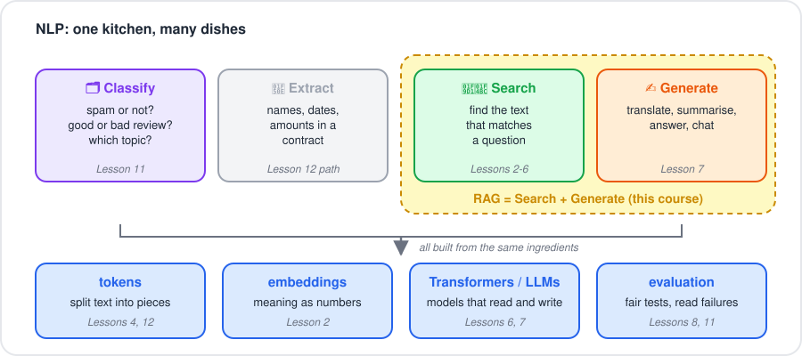

---
jupytext:
  text_representation:
    extension: .md
    format_name: myst
kernelspec:
  display_name: Python 3
  language: python
  name: python3
---

# Lesson 11 · The bigger picture: where RAG sits in NLP

> **In one sentence:** NLP is the whole field of teaching computers to work with human language;
> RAG is one popular "recipe" built from NLP ingredients - and you've already learned several of them.

**Time:** about 45 minutes · **You will:** see the map of NLP, learn which parts you already know,
and solve a classic NLP task - sorting text into topics - three different ways.

---

## NLP is the kitchen, RAG is one dish

**NLP** stands for **Natural Language Processing**: everything to do with computers and human
language (English, Chinese, ... - "natural" as opposed to programming languages). It's a big
field, and it has been around since the 1950s.

Think of NLP as **cooking**. Cooking has:

- **basic techniques** - chopping, boiling, frying - that you use in almost every dish;
- **many different dishes** - soup, cake, stir-fry - each a different combination of techniques.

In NLP, the **techniques** are things like splitting text into words, turning text into numbers,
and generating text. The **dishes** are the tasks people want done: translating, sorting emails,
answering questions...

**RAG is one dish.** It combines the "search" techniques (Lessons 2-6) with the "generate"
technique (Lesson 7) to answer questions from your own documents. So you've already been cooking
NLP for ten lessons - you just didn't call it that.



*The NLP map. The four families of tasks on top are built from the shared ingredients at the
bottom. RAG (highlighted) is "Search" and "Generate" working together.*

### The four families of NLP tasks

| Family | Everyday example | In this course? |
|---|---|---|
| **Classify** - put text into a box | Is this email spam? Is this review positive or negative? | ✏️ **this lesson** |
| **Extract** - pull out specific pieces | Find every person, date and amount in a contract | not covered (see Lesson 12) |
| **Search** - find the text that matches | Which page of the manual answers my question? | ✅ Lessons 2-6 |
| **Generate** - write new text | Translate, summarise, answer, chat | ✅ Lesson 7 |

### A very short history (so the names make sense)

| When | Big idea | You met it in |
|---|---|---|
| 1950s-80s | Hand-written **rules** ("if the email contains *free money*, it's spam") | - |
| 1990s-2000s | **Counting words** and statistics (TF-IDF, BM25) | Lesson 4 |
| 2013 | **Word vectors**: meaning as numbers (word2vec) | Lesson 2 |
| 2017 | The **Transformer**, a neural network that reads whole sentences at once | the models in Lessons 2, 6, 7 |
| 2018-now | Huge pretrained **language models** (BERT, GPT, ...) | Lesson 7 |
| 2020-now | **RAG**: give the language model your own documents | the whole course |

---

## Hands-on: sorting text into topics ("text classification")

Text classification is probably the most common NLP task in the real world: sorting support
tickets, flagging spam, tagging news articles. Let's try it on our own library.

**The task:** each section of our Python documentation belongs to one of four topics:

- *files & data formats* (json, csv, zip files...),
- *numbers & maths*,
- *running things at the same time* (threads, asyncio...),
- *text* (searching and formatting text).

Given a section the computer has **never seen**, can it guess the topic?

```{code-cell} ipython3
from collections import Counter
from raglab.nlp import topic_split, TOPICS

train, test = topic_split()
print("Training examples:", len(train), " Test examples:", len(test))
print("Test examples per topic:", dict(Counter(e.label for e in test)))
print("\nOne example:")
print("LABEL:", test[0].label)
print("TEXT :", test[0].text[:300])
```

**What you should see:** about 220 training examples and about 60 test examples.

```{admonition} A fair exam (remember Lesson 8?)
:class: important
The test examples come from **whole pages the computer never sees during training** - for example
the `csv` and `statistics` pages are kept back completely. Otherwise it could cheat by learning
that anything mentioning `csv.` is about files. We'll see how big that cheat is at the end.
```

### How do we score it? Accuracy

The simplest score for classification is **accuracy**: the share of guesses that are right.
If the computer guesses 10 sections and gets 7 right, accuracy = 7 / 10 = 0.7 (70%).

### ✏️ Exercise 11.1 · Write accuracy

You get two lists of the same length: `predictions` (the computer's guesses) and `labels` (the
correct answers). Compare them **position by position** and return the share that match.

**Hint:** `zip(predictions, labels)` walks through both lists together. Count the pairs where
`prediction == label`, then divide by `len(labels)`.

```{code-cell} ipython3
def accuracy(predictions: list[str], labels: list[str]) -> float:
    # YOUR CODE HERE
    raise NotImplementedError
```

```{code-cell} ipython3
from raglab.checks import check_accuracy
check_accuracy(accuracy)
```

The rest of this lesson uses a ready-made accuracy function, so it works even before you finish:

```{code-cell} ipython3
def score(predictions, labels):
    return sum(p == l for p, l in zip(predictions, labels)) / len(labels)

test_texts = [e.text for e in test]
test_labels = [e.label for e in test]
```

---

### Way 1 · Learn from word counts (the 1990s way)

We show the computer the 220 training examples **with** their topics, and it learns which words
tend to appear with which topic - like a child learning that "goal" and "penalty" usually mean a
football story. Learning from labelled examples is called **supervised learning**, and the
learner is called a **classifier**.

We turn each text into word counts (the TF-IDF method - BM25's older cousin from Lesson 4) and
use a standard classifier called *logistic regression*. You don't need to know how it works
inside: think of it as "learn a weight for every word, per topic".

```{code-cell} ipython3
from sklearn.feature_extraction.text import TfidfVectorizer
from sklearn.linear_model import LogisticRegression

word_counter = TfidfVectorizer()
train_counts = word_counter.fit_transform([e.text for e in train])
test_counts = word_counter.transform(test_texts)

classifier = LogisticRegression(max_iter=2000).fit(train_counts, [e.label for e in train])
predictions_words = classifier.predict(test_counts)
print(f"Accuracy with word counts: {score(predictions_words, test_labels):.0%}")
```

**What you should see:** only about **55%**. The test pages use many words the classifier never
saw in training (`gzip`, `fraction`, `wrap`...), so it's guessing a lot.

### Way 2 · Learn from meaning (embeddings)

Same classifier, but instead of word counts we give it the **embeddings** from Lesson 2 - the
"map of meaning" numbers. Now *"compress"* and *"zip"* look similar even if the words differ.

```{code-cell} ipython3
from raglab.embeddings import get_embedder

model = get_embedder()
train_vectors = model.embed_passages([e.text for e in train])
test_vectors = model.embed_passages(test_texts)

classifier = LogisticRegression(max_iter=2000).fit(train_vectors, [e.label for e in train])
predictions_meaning = classifier.predict(test_vectors)
print(f"Accuracy with embeddings: {score(predictions_meaning, test_labels):.0%}")
```

**What you should see:** about **70-75%** - a big jump, just from describing text by meaning
instead of by exact words. This is exactly why the meaning librarian helped in Lesson 3.

### Way 3 · No training at all ("zero-shot")

Here's a trick that would have seemed like magic 15 years ago. We don't use the training
examples at all. Instead we just **describe** each topic in words, embed the descriptions, and
give each test section the topic whose description is **closest on the map** - exactly like the
librarian in Lesson 3, but searching among topic descriptions instead of cards.

"Zero-shot" means "zero examples needed".

```{code-cell} ipython3
import numpy as np

topic_names = list(TOPICS)
descriptions = {name: f"Python documentation about {name}" for name in topic_names}

def zero_shot(descriptions):
    description_vectors = np.stack([model.embed_query(descriptions[n]) for n in topic_names])
    closest = (test_vectors @ description_vectors.T).argmax(axis=1)   # nearest description
    return [topic_names[i] for i in closest]

predictions_zero = zero_shot(descriptions)
print(f"Accuracy with zero examples: {score(predictions_zero, test_labels):.0%}")
```

**What you should see:** around **85%** - better than both trained classifiers, with no training
examples at all. The embedding model already learned a lot about language from millions of
sentences; we just borrowed that knowledge. This "reuse a model trained on huge amounts of text"
idea is the heart of modern NLP.

```{admonition} Why did "no training" win here?
:class: note
We only had about 220 training examples, and the test pages talk about different specific things.
With thousands of examples, trained classifiers usually catch up and win. The lesson isn't
"never train" - it's **"try the cheap zero-shot baseline first"**.
```

### ✏️ Exercise 11.2 · Write better topic descriptions (no checker)

The descriptions above are very plain. Change them to describe each topic in more detail - for
example `"Python functions for reading and writing files, compressing data and saving data in
formats like JSON and CSV"`. Run the box and watch the accuracy. Can you beat 85%?

You are doing **prompt engineering** for a classifier: choosing the right words to describe what
you want.

```{code-cell} ipython3
my_descriptions = {
    "files & data formats": "Python documentation about files & data formats",
    "numbers & maths": "Python documentation about numbers & maths",
    "running things at the same time": "Python documentation about running things at the same time",
    "text": "Python documentation about text",
}   # <- improve these
print(f"Accuracy: {score(zero_shot(my_descriptions), test_labels):.0%}")
```

---

## The cheating trap, measured

What if we had **not** kept whole pages back, and instead shuffled all sections randomly into
training and test? Sections from the *same page* would then appear on both sides - and they share
very specific words (`csv.reader`, `csv.writer`, ...). Let's measure Way 1 again with that
unfair split:

```{code-cell} ipython3
import random
from raglab.nlp import topic_examples

everything = topic_examples()
random.Random(0).shuffle(everything)
cut = int(len(everything) * 0.7)
unfair_train, unfair_test = everything[:cut], everything[cut:]

counter = TfidfVectorizer()
unfair = LogisticRegression(max_iter=2000).fit(counter.fit_transform([e.text for e in unfair_train]),
                                               [e.label for e in unfair_train])
unfair_predictions = unfair.predict(counter.transform([e.text for e in unfair_test]))
print(f"Word counts, UNFAIR random split: {score(unfair_predictions, [e.label for e in unfair_test]):.0%}")
print(f"Word counts, fair split (Way 1):  {score(predictions_words, test_labels):.0%}")
```

**What you should see:** about **95%** with the unfair split versus about **55%** with the fair one.
Same method, same data - the only difference is whether the exam leaked. This is the single most
common mistake in NLP and machine learning projects, and now you've seen it with your own eyes.

---

## Bonus: let the AI writer classify (optional, needs the writer)

Large language models can classify too: just ask. This is zero-shot with a much bigger model.
We try the first 12 test sections (12 AI calls):

```{code-cell} ipython3
from raglab import llm

PROMPT = """Which topic does this Python documentation section belong to?
Topics: {topics}
Reply with the topic name only.

Section:
{text}"""

if llm.llm_available():
    sample = test[:12]
    answers = [llm.chat(PROMPT.format(topics="; ".join(topic_names), text=e.text[:1500])).strip().lower()
               for e in sample]
    guesses = [next((n for n in topic_names if n in a), a) for a in answers]
    print(f"LLM accuracy on {len(sample)} sections: {score(guesses, [e.label for e in sample]):.0%}")
else:
    print(llm.explain_setup())
```

LLMs are often very accurate at this, but each guess costs an AI call (time and money). For
millions of emails a day, the embedding approach is thousands of times cheaper. Choosing the
right tool for the size of the job is a big part of NLP work.

---

## Common mix-ups

- **"NLP and RAG are alternatives."** No - RAG is *part of* NLP, built from NLP techniques.
- **"NLP means chatbots."** Chatbots are one dish. Spam filters, translation and search engines
  are NLP too.
- **"High accuracy = good model."** Only if the test was fair. Always ask: *could the test
  examples have leaked into training?*

## Recap

- **NLP** = computers working with human language. Four task families: classify, extract,
  search, generate. **RAG** = search + generate.
- **Text classification** = putting text into boxes. Score it with **accuracy**.
- Word counts < embeddings < zero-shot with good descriptions - on *this* small dataset.
- A leaked test set can turn 55% into a fake 95%.

**Next lesson:** a map for continuing your NLP journey, using the best free courses on GitHub.

## Want to go deeper? (optional)

- *pytorch-sentiment-analysis* (bentrevett) - text classification step by step, from simple to
  Transformer models: [GitHub](https://github.com/bentrevett/pytorch-sentiment-analysis) ·
  `references/bentrevett_pytorch-sentiment-analysis/`
- *Hugging Face course*, chapter 1 shows zero-shot classification and other NLP tasks in a few
  lines: [GitHub](https://github.com/huggingface/course) · `references/huggingface_course/chapters/en/chapter1/`
