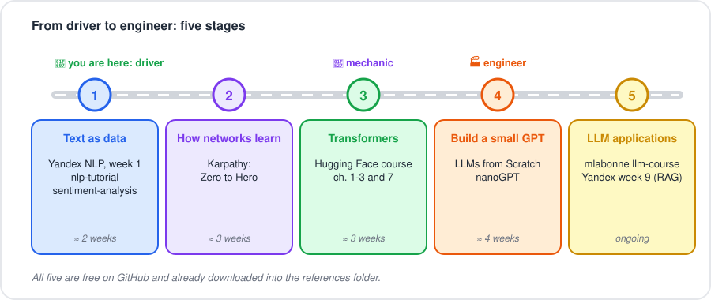

---
jupytext:
  text_representation:
    extension: .md
    format_name: myst
kernelspec:
  display_name: Python 3
  language: python
  name: python3
---

# Lesson 12 · Your NLP learning path (what to study next)

> **In one sentence:** a step-by-step route from "I can build RAG" to "I understand how language
> models work inside", using the best free courses on GitHub - each step building on the last.

**Time:** 20 minutes to read, then several months of self-study at your own pace ·
**You will:** see how a language model really reads text, then pick your next steps.

---

## Where you are now

Think of learning NLP like learning to drive and then becoming a mechanic:

- 🚗 **Driver** - you can *use* the car well. **That's you now**: you can use embedding models,
  re-rankers and LLMs to build a working RAG system, and measure it.
- 🔧 **Mechanic** - you understand what's under the bonnet: how a model turns text into numbers,
  how it learns, how a Transformer works.
- 🏭 **Engineer** - you can build an engine yourself: train a small language model from scratch.

You don't *need* to become a mechanic to build good RAG systems - plenty of excellent
engineers stay drivers. But understanding the engine makes you much better at diagnosing
problems ("why does the model ignore negations?") and at reading new research.

---

## A first look under the bonnet: how a model actually reads text

In Lesson 4, our keyword librarian split text into **whole words**. Modern language models do
something cleverer: they split text into **tokens** - common words stay whole, but rare words get
broken into smaller pieces they've seen before. It's like reading an unfamiliar long word by
recognising its parts: *un + believ + able*.

The box below uses the real tokenizer from our embedding model (the same one from Lesson 2):

```{code-cell} ipython3
from raglab.embeddings import get_embedder

tokenizer = get_embedder().model.tokenizer

for text in ["The cat sat on the mat.",
             "shutil.rmtree deletes a directory tree",
             "Unbelievably, the tokenizer handles anything!"]:
    print(f"{text!r}\n   -> {tokenizer.tokenize(text)}\n")
```

**What you should see:**

- common words like `the`, `cat`, `sat` stay whole;
- rare words are split, e.g. `rmtree` becomes something like `rm` + `##tree`
  (`##` means "this piece continues the previous one");
- punctuation like `.` and `!` become their own tokens.

Why does this matter for you?

- **Cost and limits:** AI providers charge **per token**, and every model has a maximum number of
  tokens it can read. Long chunks (Lesson 1) cost more.
- **Strange behaviour:** a model "sees" `rmtree` as two unrelated-looking pieces. That's part of
  why embeddings struggle with exact names (Lesson 2) - and why BM25 is still useful.

### ✏️ Exercise 12.1 · Count tokens (no checker)

Using `len(tokenizer.tokenize(text))`, compare how many tokens these need:

1. one of our documentation sections (try `load_documents("python_docs")[0].text[:1000]`),
2. the same length of everyday English (write a 1000-character paragraph yourself),
3. a long list of numbers like `"3.14159 2.71828 1.41421 ..."`.

Which kind of text is "most expensive" per character? Rule of thumb to check: in everyday
English, 1 token ≈ 4 characters ≈ ¾ of a word.

```{code-cell} ipython3
from raglab import load_documents

sample = load_documents("python_docs")[0].text[:1000]
print(len(sample), "characters ->", len(tokenizer.tokenize(sample)), "tokens")
# Your experiments here
```

---

## The learning path: five stages



*Five stages from driver to engineer. Each stage lists the best free resource for it; the local
copies are in the `references` folder on the left.*

The resources below are popular, free GitHub courses (star counts in November 2026). Each one is
already downloaded into the `references` folder, so you can open the notebooks straight away in
JupyterLab. They're written by other people, so their style is more technical than this course -
expect to read slowly and re-watch videos. **That's normal.**

### Stage 1 · Text as data (about 2 weeks)

*Goal: understand how text becomes numbers - you already know the basics from Lessons 2 and 4.*

| Resource | What to do | Where |
|---|---|---|
| **Yandex NLP course**, week 1 (MIT licence, 10.8k ⭐) - a full university course | Do the `seminar.ipynb` on word embeddings | [GitHub](https://github.com/yandexdataschool/nlp_course) · `references/yandexdataschool_nlp_course/week01_embeddings/` |
| **graykode/nlp-tutorial** (MIT, 14.9k ⭐) - each classic model in under 100 lines | Read `1-2.Word2Vec` - how word vectors are learned | [GitHub](https://github.com/graykode/nlp-tutorial) · `references/graykode_nlp-tutorial/1-2.Word2Vec/` |
| **pytorch-sentiment-analysis** (MIT, 4.6k ⭐) | Notebook 1, *Neural Bag of Words* - Lesson 11's task with a neural network | [GitHub](https://github.com/bentrevett/pytorch-sentiment-analysis) · `references/bentrevett_pytorch-sentiment-analysis/` |

### Stage 2 · How neural networks learn (about 3 weeks)

*Goal: understand what "training a model" really means. This is the biggest step - take your time.*

| Resource | What to do | Where |
|---|---|---|
| **Neural Networks: Zero to Hero** by Andrej Karpathy (MIT, 26k ⭐) - famous YouTube lectures where he codes everything live | Watch and code along with `micrograd`, then `makemore` parts 1-2 | [GitHub](https://github.com/karpathy/nn-zero-to-hero) · `references/karpathy_nn-zero-to-hero/lectures/` |

```{admonition} Tip
:class: tip
Karpathy's videos are on YouTube (search "Neural Networks: Zero to Hero"). Watch with the
notebook open and **type the code yourself** rather than just watching - that's where the
learning happens.
```

### Stage 3 · Transformers and pretrained models (about 3 weeks)

*Goal: understand the Transformer - the engine inside every model you used in this course - and
learn the standard tools for using pretrained models.*

| Resource | What to do | Where |
|---|---|---|
| **Hugging Face course** (Apache-2.0, 4.4k ⭐) - the official course for the most-used NLP library | Chapters 1-3 (what Transformers can do, using them, fine-tuning), then chapter 7 for classic tasks like finding names in text (the "Extract" family from Lesson 11) | [GitHub](https://github.com/huggingface/course) · `references/huggingface_course/chapters/en/` · also readable online at huggingface.co/learn |
| **graykode/nlp-tutorial** | `5-1.Transformer` and `5-2.BERT` - the key models in compact code | `references/graykode_nlp-tutorial/` |
| **Yandex NLP course** | Weeks 3-4: attention and transfer learning | `references/yandexdataschool_nlp_course/week03_attention/` |

### Stage 4 · Build a small GPT yourself (about 4 weeks)

*Goal: become the "engineer" - build and train a small ChatGPT-like model with your own code.*

| Resource | What to do | Where |
|---|---|---|
| **LLMs from Scratch** by Sebastian Raschka (109k ⭐) - a book's worth of notebooks | Chapters 2-5: tokenizing, attention, building GPT, pretraining. Chapters 6-7 fine-tune it for classification and for following instructions | [GitHub](https://github.com/rasbt/LLMs-from-scratch) · `references/rasbt_LLMs-from-scratch/ch02/` … `ch07/` |
| **nanoGPT** by Andrej Karpathy (MIT, 65k ⭐) - the smallest "real" GPT training code | After Raschka (or after Karpathy's video *Let's build GPT*), train the tiny Shakespeare model | [GitHub](https://github.com/karpathy/nanoGPT) · `references/karpathy_nanoGPT/` |

### Stage 5 · LLMs in real applications (ongoing)

*Goal: come back to building things - RAG, agents, evaluation, deployment - now with an
understanding of the engine.*

| Resource | What to do | Where |
|---|---|---|
| **LLM course** by Maxime Labonne (Apache-2.0, 85k ⭐) - a roadmap with links and notebooks | The *LLM Engineer* part: RAG, agents, evaluation, deployment. The *LLM Scientist* part if you liked Stage 4 | [GitHub](https://github.com/mlabonne/llm-course) · `references/mlabonne_llm-course/README.md` |
| **Yandex NLP course**, week 9 | A university lecture and practice notebook on retrieval and RAG - see how much of it you already know! | `references/yandexdataschool_nlp_course/week09_retrieval/` |
| **This course, Lesson 10's map** | Revisit the advanced RAG techniques with fresh eyes | Lesson 10 |

### Theory on the side (any time)

If you like lectures and want the deeper "why":

- **Stanford CS224N - NLP with Deep Learning** - the best-known university NLP course; lectures
  are free on YouTube and the course site is web.stanford.edu/class/cs224n.
- **Oxford Deep NLP 2017** (15.8k ⭐) - lecture slides as PDFs:
  `references/oxford-cs-deepnlp-2017_lectures/` (Lecture 2a on word meaning and Lecture 11 on
  question answering connect directly to this course).

---

## How to study (advice that actually works)

1. **One stage at a time.** Don't open five courses at once. Finish Stage 1 before Stage 2.
2. **Type the code, don't just read it.** Copy a notebook into `workspace/`, run it, break it,
   fix it.
3. **Connect it back.** After each stage, ask: *where did I see this in RAG Lab?* (Word vectors →
   Lesson 2. Attention → the re-ranker in Lesson 6. Fine-tuning → could I fine-tune the
   classifier from Lesson 11?)
4. **Measure everything.** The habit from Lesson 8 - fair test sets, reading the failures - is
   what separates real NLP work from demos.
5. **Small, regular sessions beat marathons.** 45 minutes a day, five days a week, gets you
   through all five stages in about four months.

### ✏️ Exercise 12.2 · Make your plan (no checker)

In the box below, write (as comments) your personal plan: which stage you'll start with, which
resource, and what you'll have built by the end of the first month. Then look at it again in a
month.

```{code-cell} ipython3
# My NLP plan:
# Stage I'm starting with:
# First resource:
# By the end of month 1 I will have built:
```

---

## Recap

- You're now a confident **driver**: you can build and measure RAG systems.
- Language models read **tokens** - pieces of words - which affects cost, limits and behaviour.
- Five stages to go deeper: text as data → how networks learn → Transformers → build a GPT →
  real applications.
- All the recommended courses are free, on GitHub, and already in your `references` folder.

🎓 **You've reached the end of RAG Lab.** Thank you for learning with us - and good luck on the road ahead!
